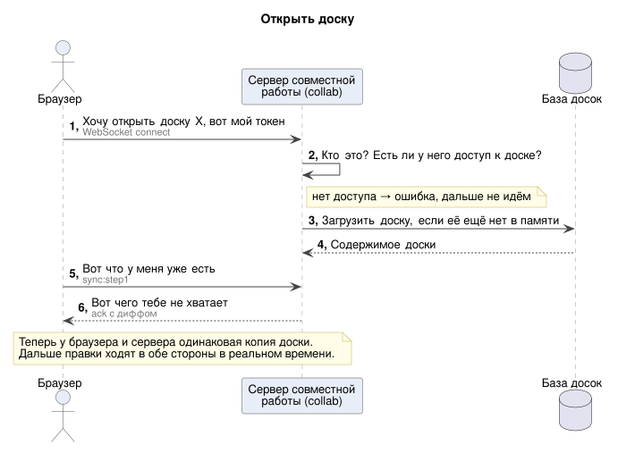
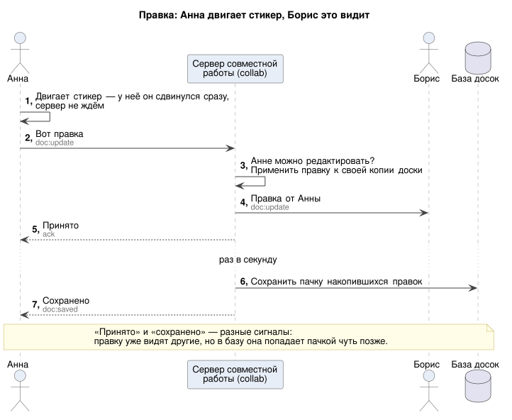
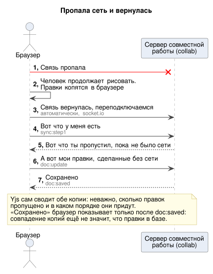
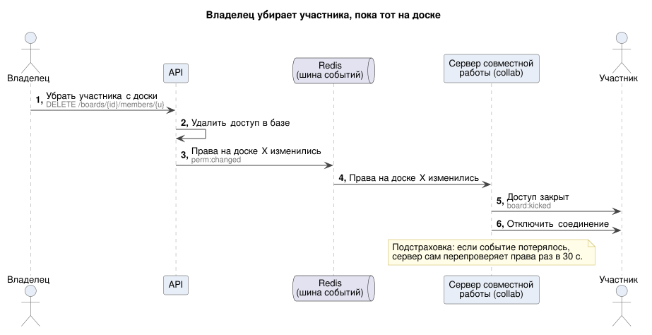

# Realtime API: socket.io-события

> Транспорт: **socket.io** (требование ТЗ) поверх WebSocket, namespace `/collab`, `transports: ['websocket']` (без long-polling → без sticky sessions на балансировщике).
> Содержимое доски — бинарные обновления **Yjs** (`Uint8Array`, socket.io передаёт binary без base64). Остальное — JSON.
> Нагрузка: ~200 соединений, ~550 входящих и ~820 исходящих сообщений/с в пике ([README §3](../README.md#3-нагрузка-сводка)).

## 0. Принципы

1. **Одно соединение = одна открытая доска.** `boardId` передаётся в handshake, поэтому балансировщик может маршрутизировать по доске (board affinity, см. [deep-dive §4](../deep-dive.md#4-несколько-инстансов-redis-adapter-и-board-affinity)). Каталог и прочий UI работают через REST.
2. **Права проверяются дважды:** при подключении к доске и **на каждом пишущем событии** (роль лежит в `socket.data.role` и обновляется при изменении прав).
3. **Порядок и дубли не важны** для `doc:*`: обновления Yjs коммутативны и идемпотентны. Повторная доставка ничего не ломает.
4. **Эфемерное отдельно от постоянного:** `awareness:*` (курсоры, выделение) никогда не пишутся в БД и могут теряться (`volatile`).
5. **«Принято» и «сохранено» — разные сигналы (Р-32).** ack на `doc:update` (`emitWithAck`) значит «сервер принял, проверил и разослал правку», и в нём есть номер правки `n` на этом сокете. Событие `doc:saved {upTo}` значит «все правки до `n` включительно закоммичены в БД и переживут падение сервера». Не дождался ack — при реконнекте всё равно досинхронизируется.

## 1. Подключение (handshake)

```ts
const socket = io('wss://collab.example.com/collab', {
  transports: ['websocket'],
  auth: { token: accessToken, protocolVersion: 1 }, // JWT (при истечении — auth:refresh) и версия протокола
  query: { boardId },
  reconnectionDelay: 500,                // экспоненциальный backoff...
  reconnectionDelayMax: 10_000,
  randomizationFactor: 0.5,              // ...с jitter: после падения процесса все его клиенты не придут одновременно
});
```

Сервер (middleware `io.use`):

1. проверяет JWT → `socket.data.userId`; `protocolVersion` ниже минимальной → `connect_error {code: 'UPGRADE_REQUIRED'}`, клиент показывает «обновите страницу» и не переподключается ([deep-dive §17](../deep-dive.md#версии-клиента-и-схемы-р-28));
2. проверяет `Origin` (защита от cross-site WebSocket hijacking);
3. считает роль на доске → `socket.data.role`. Нет доступа → `connect_error` с `{code: 'NOT_FOUND'}`;
4. проверяет лимиты: на доске ≤ 100 редакторов и ≤ 300 зрителей, иначе `{code: 'BOARD_FULL'}`. Доска ещё копируется (`status = copying`) → `{code: 'BOARD_NOT_READY'}` ([deep-dive §16](../deep-dive.md#доска-копирование-boardsstatus));
5. `socket.join(['board:' + boardId, 'user:' + userId, 'board:' + boardId + ':user:' + userId])`:
   - `board:{id}` — рассылка правок и событий доски;
   - `user:{id}` — персональные события: ИИ, уведомления. Сюда попадают все вкладки пользователя на всех досках, поэтому события несут `boardId`, и клиент фильтрует их сам;
   - `board:{id}:user:{id}` — точечное действие над пользователем на одной доске: отключение при отзыве, смена роли (§4.4).

## 2. События клиент → сервер

| Событие | Payload | Кто может | Ack | Что делает сервер |
|---|---|---|---|---|
| `sync:step1` | `{ stateVector: Uint8Array }` | viewer+ | `{ update: Uint8Array, stateVector: Uint8Array }` | возвращает дифф «чего у клиента нет» (`Y.encodeStateAsUpdate(doc, clientSV)`) и свой state vector, чтобы клиент дослал то, чего нет у сервера (офлайн-правки) |
| `doc:update` | `{ update: Uint8Array }` | **editor+** | `{ ok: true, n }` или `{ ok: false, n?, code }` | проверяет роль, размер (≤ 1 МБ), rate limit (≤ 30/с); применяет к серверному `Y.Doc`. Если применение ничего не изменило (полный повтор) — сразу ack, без рассылки и записи. Иначе проверяет изменённые элементы (включая вложенные поля и текст) по схеме, циклы и лимит элементов, невалидное чинит своей правкой ([deep-dive §17](../deep-dive.md#17-проверка-содержимого-правок-и-версии-клиента)); рассылает в комнату (кроме отправителя); ставит в пачку на запись в БД. `n` — номер принятой правки на этом сокете, после записи придёт `doc:saved` |
| `sync:chunk` | `{ transferId: uuid, index, total, bytes: Uint8Array }` | **editor+** | `{ ok: true, next }` или `{ ok: false, code }`; на последнем куске — как у `doc:update` | кусок большого update (> 512 КБ), §4.3. Сервер собирает куски в памяти и, когда пришли все, обрабатывает целое как `doc:update`. Следующий кусок клиент шлёт только после ack (обратное давление) |
| `awareness:update` | `{ update: Uint8Array }` (y-protocols/awareness: курсор, выделение, имя, цвет) | viewer+ | нет (`volatile`) | rate limit ≤ 20/с; рассылает в комнату. Для комнат > 10 человек склеивает пачками раз в 50 мс |
| `auth:refresh` | `{ token }` | все | `{ ok }` | обновляет срок жизни соединения; просроченный токен без refresh → отключение через 1 мин |
| `ping:latency` | `{ t }` | все | `{ t }` | замер RTT для индикатора качества связи |

**Коды ошибок в ack:** `FORBIDDEN` (viewer пишет), `RATE_LIMITED`, `TOO_LARGE`, `ELEMENT_LIMIT` (доска переполнена), `INVALID_ELEMENT` (элемент не прошёл схему; в ack есть `elementIds`, сервер уже прислал починку; 3 раза за минуту → отключение), `BOARD_READ_ONLY` (деградация: БД недоступна, буфер переполнен), `INVALID_UPDATE` (битый update или запрещённый корневой тип), `TRANSFER_EXPIRED` (передача кусками не завершилась за 60 с: начать заново с новым `transferId`).

## 3. События сервер → клиент

| Событие | Payload | Когда |
|---|---|---|
| `doc:update` | `{ update: Uint8Array }` | правка другого участника (или восстановление версии) |
| `doc:saved` | `{ upTo: n }` | пачка с правками этого сокета до `n` включительно закоммичена в БД. Клиент показывает «сохранено», когда `upTo` догнал номер его последней правки. Номера считаются в пределах одного соединения: после переподключения отсчёт заново, а несохранённое досылает `sync:step1` |
| `awareness:update` | `{ update: Uint8Array }` | курсоры, выделения, присутствие других |
| `presence:snapshot` | `{ users: [{ userId, name, avatarUrl, color, role }] }` | сразу после подключения |
| `board:permission-changed` | `{ role }` | роль изменили. Стала viewer → клиент выключает редактирование |
| `board:kicked` | `{ reason: 'access_revoked' \| 'board_deleted' \| 'session_revoked' \| 'board_full' }` | сразу после — `disconnect` |
| `version:restored` | `{ versionId, by: { userId, name }, preRestoreVersionId }` | кто-то восстановил версию. Само содержимое придёт обычными `doc:update` |
| `version:created` | `{ versionId, kind, name? }` | для панели истории (инвалидировать запрос) |
| `comments:changed` | `{ threadId }` | создан, изменён или решён тред → `queryClient.invalidateQueries(['threads', boardId])` |
| `ai:progress` | `{ requestId, status: 'running', step?: 'reading_board' \| 'generating' \| 'layout' }` | в комнату `user:{id}` |
| `ai:done` | `{ requestId, status: 'succeeded' \| 'failed', error? }` | черновик забирается `GET /ai/requests/{id}` (не шлём большой JSON всем вкладкам) |
| `file:ready` / `file:failed` | `{ fileId, previewUrl? }` | картинка обработана |
| `board:copy-done` | `{ boardId, status: 'ready' \| 'copy_failed' }` | копирование доски закончилось; в комнату `user:{id}` того, кто копировал |
| `notification:new` | `{ id, type }` | бейдж уведомлений |
| `server:degraded` | `{ mode: 'cursors_reduced' \| 'read_only', retryAfterMs? }` | сервер включил деградацию |

## 4. Жизненный цикл

### 4.1. Открытие доски



<sub>Упрощённая схема. [Подробная версия](../sequences/detailed/01-open-board.svg) — со всеми проверками, ошибками и SQL.</sub>

<details>
<summary>Текстовая версия схемы</summary>

```
Client                                 Collab instance                         Postgres collab
  │── connect(boardId, token) ───────────▶│ auth + роль + лимиты
  │                                        │ Y.Doc в памяти? нет → SUBSCRIBE collab:doc:{id} (копим правки соседей),
  │                                        │ затем загрузить одним снимком ────────▶ board_documents.state
  │                                        │ (REPEATABLE READ, deep-dive §7)       + все оставшиеся board_updates доски
  │                                        │ + применить накопленное
  │◀── presence:snapshot ──────────────────│
  │── sync:step1 {SV клиента = пусто} ────▶│
  │◀── ack {update: весь документ, SV} ────│      (~100 КБ для типичной доски)
  │── doc:update (если у клиента было что-то, чего нет у сервера) ─▶
  │══ дальше: doc:update / awareness:update в обе стороны ══
```

</details>

### 4.2. Правка



<sub>Упрощённая схема. [Подробная версия](../sequences/detailed/02-edit.svg) — со всеми проверками, ошибками и SQL.</sub>

<details>
<summary>Текстовая версия схемы</summary>

```
A ── doc:update ──▶ Instance 1: role ≥ editor? размер? rate? → Y.applyUpdate(serverDoc)
                     ├─▶ io.to(board).except(A).emit('doc:update')  → B (тот же инстанс) и C (другой инстанс через Redis adapter)
                     ├─▶ PUBLISH collab:doc:{boardId}               → серверные Y.Doc на других инстансах
                     ├─▶ буфер записи (склейка Y.mergeUpdates, flush раз в 1 с) → INSERT board_updates ON CONFLICT DO NOTHING
                     ├─▶ ack {ok:true, n} → A                         «принято»
                     └─▶ (после COMMIT пачки) doc:saved {upTo: n} → A  «сохранено»
```

</details>

> **Почему два сигнала (Р-32).** Пользователь не ждёт ни того, ни другого: с CRDT правка уже применена локально и видна сразу. Ждать коммита в БД ради ack незачем, но и выдавать ack за «сохранено» нельзя.
> - Пока нет `doc:saved`, правка живёт у автора (память и IndexedDB, Р-30) и у тех, кому её уже разослали. С другого устройства её не прочитать: если collab упадёт до записи, правка вернётся на сервер, только когда кто-то из обладателей переподключится.
> - Пока collab DB недоступна, `doc:saved` не приходит вовсе, и несохранённое копится столько, сколько длится сбой, а не одну секунду.
>
> Клиент показывает состояние честно: **«сохраняется…»** (есть правки без `doc:saved`), **«сохранено»**, **«нет связи — изменения хранятся в браузере»**, **«ошибка»** (`BOARD_READ_ONLY`, `FORBIDDEN`). Обычно «сохраняется» длится ≤ 1 с.

### 4.3. Переподключение (обрыв сети, сон ноутбука, упал инстанс)



<sub>Упрощённая схема. [Подробная версия](../sequences/detailed/03-reconnect.svg) — со всеми проверками, ошибками и SQL.</sub>

1. socket.io переподключается сам: backoff + jitter, возможно, уже к другому инстансу.
2. Пока связи нет, клиент **продолжает редактировать** локальный `Y.Doc` (оптимистичный UI). Правки копятся в нём самом, отдельная очередь не нужна.
3. После `connect` — снова `sync:step1 {stateVector клиента}`:
   - сервер возвращает всё, что клиент пропустил;
   - клиент по `stateVector` сервера досылает свои офлайн-правки (`doc:update`).
4. **Обе стороны сошлись.** Неважно, сколько было пропущено и в каком порядке: CRDT сходится. Протокол тот же, что при первом открытии, отдельного «режима реконнекта» нет.
   - **Если дифф клиента больше 512 КБ** (долгий офлайн, правки из IndexedDB), он уходит кусками `sync:chunk` (Р-36). Одним `doc:update` его слать нельзя: сообщение больше `maxHttpBufferSize` (1 МБ) socket.io не отклоняет, а рвёт соединение. Клиент переподключился бы, послал то же самое и попал в бесконечный цикл.
   - Резать бинарный update на куски можно, но **применять куски по отдельности нельзя**: кусок — это не валидный update. Сервер собирает передачу целиком и только потом вызывает `Y.applyUpdate`.
   - Ограничения передачи: кусок ≤ 512 КБ, всего ≤ 12 МБ (лимит документа 10 МБ + запас), одна активная передача на сокет, 60 с на всю передачу. Следующий кусок — только после ack предыдущего.
   - Обрыв посреди передачи: собранное на сервере выбрасывается, а после реконнекта клиент заново считает дифф по новому state vector сервера и начинает с новым `transferId`.
   - В обратную сторону, от сервера к клиенту, ограничения нет: браузерный WebSocket принимает сообщения любого размера, и полный документ до 10 МБ приходит в ack `sync:step1`.
5. Если за время офлайна доступ отозвали или доска удалена → `connect_error` / `board:kicked`. Клиент показывает «ваши несохранённые изменения не применены» и предлагает экспортировать их в PNG.
6. Если офлайн был очень долгим (> 24 ч, вкладка «уснула»), клиент перезагружает документ с нуля. Офлайн-правки сливаются так же, но пользователь видит предупреждение.

> 🖥 На фронте: `y-indexeddb` дополнительно сохраняет локальный `Y.Doc` в браузере. Тогда офлайн-правки переживают закрытие и перезагрузку вкладки. **Входит в MVP (Р-30).** Figma отдельно делала такое автосохранение: потерю офлайн-правок при закрытой вкладке они считали настоящей потерей данных. С Yjs это несколько строк. Но это гарантия **только для этого браузера**: другое устройство и другие участники видят правку, когда она дошла до сервера и пришёл `doc:saved` (Р-32).

### 4.4. Отзыв доступа



<details>
<summary>Текстовая версия схемы</summary>

```
Owner ── DELETE /boards/{id}/members/{u} ──▶ API: транзакция в core → PUBLISH perm:changed {boardId, userId:u}
                                                  │
Collab instances (все) ◀──────────────────────────┘  server.in('board:{id}:user:u') → emit board:kicked → disconnectSockets(true)
                                                      (server — namespace /collab; работает между инстансами через Redis adapter)
```

</details>

> ⚠️ Не `io.in('user:u').in('board:{id}')`: цепочка `in()` в socket.io — это **объединение** комнат. Такой вызов отключил бы всю доску и пользователя на всех его досках. Нужна комната-пересечение `board:{id}:user:{u}` (§1).

Цель — < 5 с, если `perm:changed` дошёл, и ≤ 30 с, если потерялся ([README §2.3](../README.md#23-latency-p99)). Страховка (Р-33):
- раз в 30 с инстанс перепроверяет роли всех сокетов каждой открытой доски одним запросом на доску к primary core, мимо кэша. Это касается и viewer, который ничего не пишет;
- сразу после переподключения к Redis — внеочередная перепроверка;
- при `auth:refresh`;
- если core недоступна, остаётся последняя известная роль: отозвать доступ без core всё равно нельзя ([deep-dive §6](../deep-dive.md#6-права-доступа-в-websocket)).

## 5. Лимиты на уровне сокета

| Что | Лимит | Реализация |
|---|---|---|
| Размер сообщения | 1 МБ | `maxHttpBufferSize: 1e6`; превышение рвёт соединение, поэтому крупное — только `sync:chunk` |
| Передача кусками | кусок ≤ 512 КБ, всего ≤ 12 МБ, 1 передача на сокет, 60 с | сборка в памяти процесса; просрочка → `TRANSFER_EXPIRED` |
| `doc:update` | 30/с, burst 60 | token bucket в памяти процесса (сокет живёт на одном инстансе) |
| `awareness:update` | 20/с | лишнее молча отбрасывается |
| Подключений на пользователя | 10 (вкладки) | счётчик в Redis |
| Ожидающих ack на сокет | 100 | защита памяти от «медленного» клиента |

## 6. Как это тестировать

- **Unit:** guard прав (`viewer` → `FORBIDDEN` на `doc:update`), rate limiter.
- **Интеграционные** (`socket.io-client` в Vitest/Jest, реальный Redis через testcontainers):
  - два клиента одновременно меняют одно поле → оба сходятся к одинаковому значению;
  - клиент B отключается, A делает 100 правок, B переподключается → `docA.toJSON()` и `docB.toJSON()` совпадают;
  - одна и та же `doc:update` отправлена дважды → в документе один элемент, повтор не попал в лог;
  - отзыв доступа → `board:kicked` < 5 с; отзыв при **заглушённом** `perm:changed` → viewer без исходящих сообщений отключён ≤ 30 с;
  - X открыт на двух досках, доска Y открыта у X и Z: отзыв X на Y отключает только соединение X–Y;
  - `doc:saved` получен → collab убит `kill -9` → клиент в чистом браузере видит правку;
  - дифф > 1 МБ доходит кусками, в том числе с обрывом посреди передачи;
  - **разрыв только Redis** при двух инстансах: клиенты не переподключаются, правят разные элементы; Redis вернулся → все копии сошлись;
  - **два инстанса** (два `INestApplication` в одном тесте или docker compose): A на первом, B на втором — B видит правку A (требование ТЗ).
- **Нагрузочные:** artillery (есть движок socket.io) или k6 с WebSocket: 1 000 «ботов» двигают курсоры на 100 досках, меряем p99 доставки и CPU инстанса. Отсюда реальное «msg/s на процесс» для расчёта хостов.
