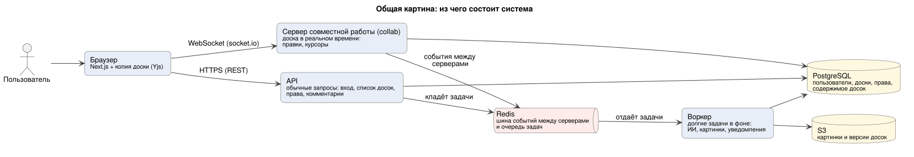
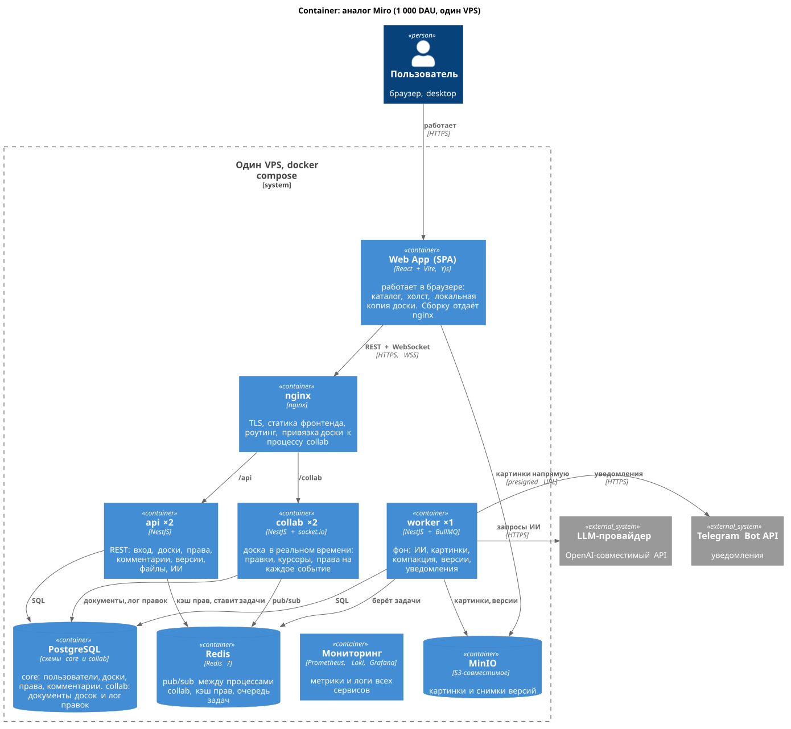
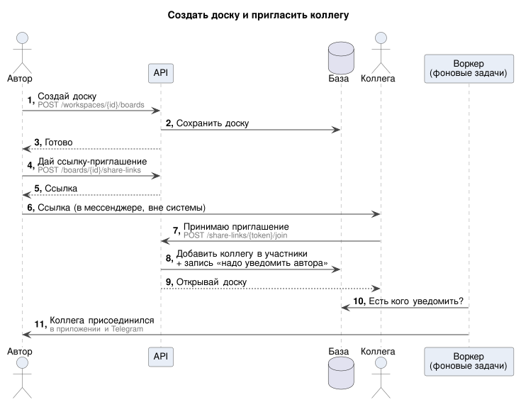
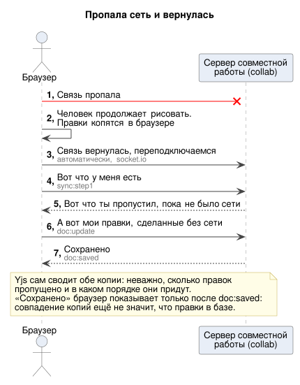
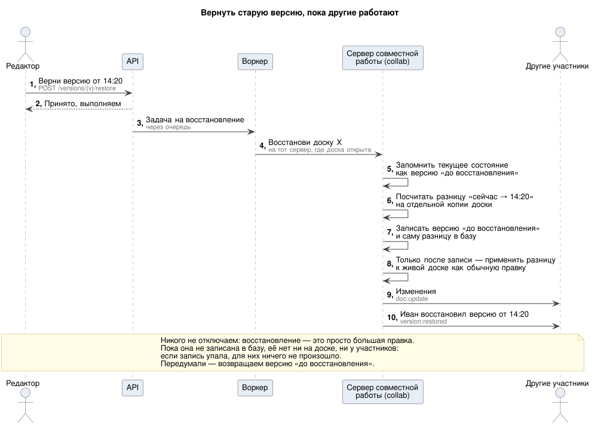
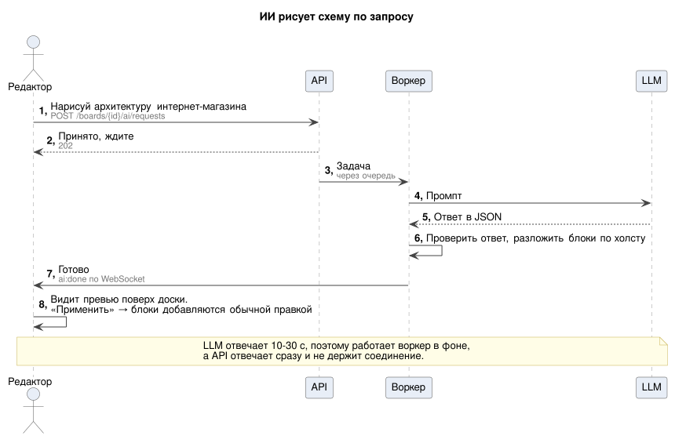
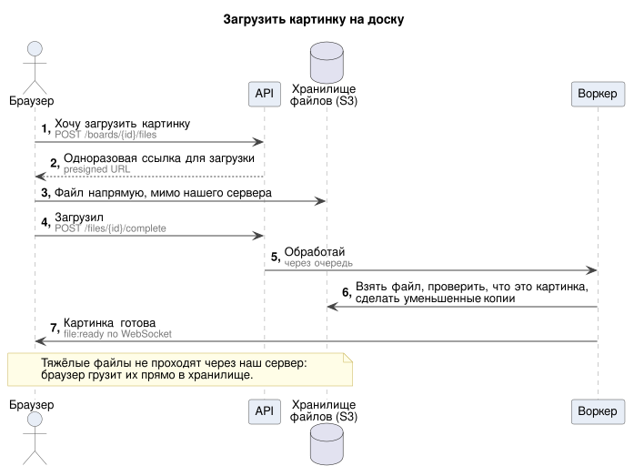

# Архитектура

> Схемы: [overview.puml](overview.puml) (общая картина) и [containers.puml](containers.puml) (C4, контейнеры), отрендеренные SVG лежат рядом.
> Последовательности взаимодействия по сценариям — в [../sequences/](../sequences/README.md).
> Исходники — `.puml`, SVG генерируются скриптом [../scripts/render.sh](../scripts/render.sh). Для живого превью — расширение **PlantUML** для VS Code (`Alt+D`). C4-PlantUML подключается из стандартной библиотеки PlantUML (`!include <C4/...>`), интернет не нужен.

## Схемы

### Общая картина (начните отсюда)



Браузер ходит в систему двумя путями: обычными HTTP-запросами в **API** (вход, список досок, комментарии) и постоянным WebSocket-соединением с **сервером совместной работы** (сама доска в реальном времени). Всё долгое (ИИ, обработка картинок, уведомления) уходит в очередь, и его делает **воркер** в фоне. Ниже — то же самое подробнее, в нотации C4, и внешние сервисы.

### Контейнеры (C4)



### Внешние сервисы

| Сервис | Зачем | Когда |
|---|---|---|
| LLM-провайдер (OpenAI-совместимый API) | ИИ-помощник: генерация схем и идей, действия над выделением | веха 8 (Р-57) |
| Telegram Bot API | уведомления; пользователь привязывает аккаунт через `/start` | веха 5 |
| GitHub OAuth | вход через GitHub | веха 9 (Р-55) |
| Sentry | ошибки фронта и бэка | веха 3 (T3-13) |
| Почтовый сервер | подтверждение почты, сброс пароля, приглашения по email | не в MVP (Р-55) |

## 1. Что запущено на сервере

Всё работает на одном VPS в docker compose ([Р-44](../decisions.md#масштаб-и-инфраструктура)). Схемой это показано [выше](#контейнеры-c4), здесь — список сервисов.

| Сервис | Сколько | Как к нему попадает трафик | Что делает |
|---|---|---|---|
| `nginx` | 1 | снаружи, порт 443 | TLS; `/` — статика фронтенда (сборка Vite, для путей SPA — `index.html`), `/api` → `api`, `/collab/` → `collab` с привязкой доски к процессу (hash по `boardId` из query handshake; клиент подключается с `path: '/collab/socket.io'`, [websocket.md §1](../api/websocket.md#1-подключение-handshake)); `files.<домен>` → `minio:9000` без проверки доступа в nginx: её делает подпись presigned URL |
| `api` | 2 | через nginx, `/api` | REST: вход, доски, права, комментарии, версии, файлы, ИИ-запросы; пишет outbox |
| `collab` | 2 | через nginx, `/collab` (WebSocket) | доска в реальном времени: держит `Y.Doc` в памяти, проверяет права на каждое событие, пишет лог правок |
| `worker` | 1 | только из очереди | фоновые задачи: ИИ, картинки, компакция, версии, уведомления |
| `postgres` | 1 | внутренняя сеть | схемы `core` и `collab` |
| `redis` | 1 | внутренняя сеть | pub/sub между процессами `collab`, кэш прав, rate limit, очередь BullMQ |
| `minio` | 1 | внутренняя сеть; браузер — только через nginx по `https://files.<домен>` и только по presigned URL (бакет приватный) | картинки и снимки версий |
| `prometheus`, `loki`, `promtail`, `grafana`, `node_exporter`, `cadvisor` | по 1 | Grafana — через nginx, остальное внутри | метрики, логи, дашборды, алерты |

Наружу смотрит только nginx. Внешние сервисы (LLM, Telegram, GitHub OAuth, Sentry) — в [таблице выше](#внешние-сервисы).

## 2. Один код — три роли запуска (модульный монолит)

Один репозиторий и один NestJS-проект, но **три точки входа**. Каждая собирается в тот же Docker-образ и запускается с разной командой:

| Роль | Entry point | Что подключает | Масштабируется по |
|---|---|---|---|
| `api` | `main.api.ts` | HTTP-контроллеры, Swagger | RPS (stateless, легко) |
| `collab` | `main.collab.ts` | socket.io gateway, Yjs, Redis adapter | соединениям и сообщениям/с (**stateful**: держит `Y.Doc` в памяти) |
| `worker` | `main.worker.ts` | BullMQ processors | длине очередей |

**Почему не микросервисы:** команда небольшая, язык один, доменные модели общие (права нужны и `api`, и `collab`). Разделить процессы по профилю нагрузки полезно: WebSocket не должен тормозить из-за генерации ИИ, а REST — из-за курсоров. Разделять код и репозитории пока не нужно: начинаем с монолита и режем его, только когда появится реальная причина.

### Модули NestJS и слои

Целевая структура `apps/server/src/`. Модуль фичи — папка прямо в `src/`, как договорились в [apps/server/README.md](../../../apps/server/README.md#как-добавлять-код):

```
src/
  auth/            # вход, JWT, refresh, guards (HTTP и WS)
  users/
  workspaces/
  boards/          # каталог, CRUD, корзина, поиск
  access/          # PermissionService: итоговая роль = max(ws, board, links); кэш; perm:changed; перепроверка раз в 30 с
  sharing/         # board_members, ссылки-приглашения
  collab/          # gateway, документы в памяти, запись лога правок, awareness
  history/         # версии, восстановление
  comments/
  files/           # presigned URL, обработка картинок
  ai/              # промпты, zod-схемы ответа, раскладка (elkjs), квоты
  notifications/   # in-app, outbox-релэй, Telegram
  infra/           # prisma, redis, s3, bullmq, логгер, метрики
  config/          # env.schema.ts — уже есть
  main.api.ts | main.collab.ts | main.worker.ts
```

Внутри модуля три слоя: `controller` / `gateway` / `processor` (транспорт) → `service` (бизнес-логика) → `repository` (Prisma). **Правило:** проверка прав живёт в одном месте (`access.PermissionService`). HTTP-guard и WS-guard — тонкие обёртки над ним, поэтому «проверить права и в HTTP, и в WS» (требование ТЗ) — это один код, а не два.

### Как это ложится на репозиторий

Монорепо на pnpm workspaces (Р-24):

| Папка | Что там | Сейчас | Что появится |
|---|---|---|---|
| `apps/web` | фронтенд: SPA на React + Vite, TypeScript, Tailwind (Р-65) | каркас из шаблона Vite | каталог, холст, страница доски (T1-10, T2-05, T2-13). Как фронт работает с бэком — [frontend.md](../frontend.md) |
| `apps/server` | бэкенд: NestJS 12 (ESM, Express, Zod, Vitest) — все три роли из одного кода | одна точка входа `main.ts`, конфиг через Zod, `GET /health`, префикс REST `/api` | три точки входа `main.api.ts` / `main.collab.ts` / `main.worker.ts` (T1-04), Prisma (T1-05), модули фич из списка выше |
| `packages/contracts` | общие для фронта и бэка zod-схемы и типы: REST, события сокета, модель элемента доски | папка `packages/` пока пустая | T1-09. До него договариваемся по [rest_api.yml](../api/rest_api.yml) и [websocket.md](../api/websocket.md) |
| `docs/system-design` | эта документация | есть | обновляем вместе с решениями ([decisions.md](../decisions.md)) |

**Куда класть код:**

- новая фича на бэке — модуль в `apps/server/src/<фича>/` ([как добавлять](../../../apps/server/README.md#как-добавлять-код));
- проверка прав — только через `access.PermissionService`, не в контроллере;
- тип, который нужен и фронту, и бэку (тело запроса, событие сокета, элемент доски), — в `packages/contracts`, а не копией в двух местах (Р-47: сначала контракт, потом код).

**Запуск локально:** `pnpm install` → `pnpm dev` (фронт — dev-сервер Vite, по умолчанию `:5173`; API на `:3001/api`) — подробно в [README репозитория](../../../README.md). Postgres, Redis и MinIO появятся в docker compose для разработки (T1-02).

## 3. Потоки данных по сценариям

### 3.1. MVP-сценарий из ТЗ: создать доску → добавить элементы → пригласить → редактировать вместе → сохранить

Диаграммы: [создать и пригласить](../sequences/05-create-and-invite.svg) · [открыть доску](../sequences/01-open-board.svg) · [правка](../sequences/02-edit.svg) · [компакция и версии](../sequences/06-compaction.svg). Подробные версии — в [../sequences/detailed/](../sequences/README.md#подробные-версии).



1. **Создать:**
   - `POST /workspaces/{id}/boards` (с `Idempotency-Key`) → `api` пишет `boards` в core;
   - пустой документ в collab создаётся лениво, при первом подключении.
2. **Открыть:**
   - `GET /boards/{id}` → мета и роль;
   - WS `connect(boardId)` → `collab` проверяет роль, загружает `Y.Doc` из collab DB (снапшот + хвост лога) → `sync:step1` → клиент получает документ.
3. **Добавить элементы:**
   - клиент создаёт стикер с **собственным uuid** в локальном `Y.Doc` и видит его мгновенно;
   - `doc:update` → `collab` применяет и рассылает правку, через ≤ 1 с пишет её пачкой в `board_updates`.
4. **Пригласить:**
   - `POST /boards/{id}/share-links {role: editor}` → ссылка;
   - второй пользователь логинится → `POST /share-links/{token}/join` → `board_link_members` (вход по ссылке хранится отдельно от явной роли, поэтому отзыв ссылки отзывает и доступ, Р-42);
   - уведомление уходит через outbox → worker → in-app + Telegram.
5. **Редактировать вместе:**
   - оба в комнате `board:{id}` и, благодаря affinity, скорее всего на одном инстансе;
   - правки идут как `doc:update`, курсоры — как `awareness:update`;
   - если инстансы разные, правки доставляются через Redis adapter.
6. **Сохранить:** отдельной кнопки нет, правки сохраняются непрерывно:
   - после коммита пачки автор получает `doc:saved`, и клиент показывает «сохранено»;
   - через 30 с тишины на доске collab ставит `compaction` (дедупликация по boardId);
   - worker вливает лог в снапшот;
   - когда уходит последний участник (или после 30 мин активности), создаётся версия в S3.

### 3.2. Обрыв сети и возврат

Клиент продолжает работать локально → socket.io переподключается (backoff + jitter) → `sync:step1` с его state vector → двусторонний дифф → состояния совпали. Подробно — [websocket.md §4.3](../api/websocket.md#43-переподключение-обрыв-сети-сон-ноутбука-упал-инстанс).



<sub>Упрощённая схема. [Подробная версия](../sequences/detailed/03-reconnect.svg) — со всеми проверками, ошибками и SQL.</sub>

### 3.3. Восстановление версии, пока на доске люди

1. `POST /versions/{v}/restore` → `api` ставит джобу `restore-{requestId}`.
2. worker вызывает внутренний эндпоинт collab через внутренний listener балансировщика с тем же хешем по `boardId`, поэтому попадает на **инстанс, который держит документ** (Р-37). Считать разницу по БД нельзя: там нет правок последней секунды.
3. collab-инстанс:
   - берёт advisory lock в collab DB (второе восстановление той же доски → `409`) и сбрасывает буфер правок;
   - загружает снапшот выбранной версии из S3;
   - синхронно, без `await` между шагами, снимает текущий документ из памяти (будущий `pre_restore`) и на **отдельной копии** вычисляет **минимальную разницу** «текущее → старое» одной транзакцией Yjs. Живой документ пока не меняется (Р-62, код — [deep-dive §5](../deep-dive.md#5-восстановление-версии-пока-другие-работают));
   - загружает снимок `pre_restore` в S3; `INSERT board_versions` и `INSERT board_updates` с разницей в той же транзакции, что и lock;
   - только после `COMMIT` — применяет разницу к живому документу, рассылает её в комнату, `PUBLISH collab:doc:{id}` и событие `version:restored`. Если S3 или `COMMIT` упали, копия выбрасывается: участники восстановления не видели, никого не отключаем, джоба повторится.
4. Участники видят изменения как чужую правку. Никого не отключаем. Правки, пришедшие параллельно, сливаются по правилам CRDT: правка элемента, который восстановление удаляет, пропадёт.



<sub>Упрощённая схема. [Подробная версия](../sequences/detailed/07-version-restore.svg) — со всеми проверками, ошибками и SQL.</sub>

### 3.4. ИИ: «сгенерируй архитектуру интернет-магазина»

1. `POST /boards/{id}/ai/requests {kind: generate_diagram, prompt, anchor}`:
   - `api` проверяет роль ≥ editor и квоту (`INCR ai:quota:...`);
   - пишет `ai_requests(queued)`;
   - ставит джобу `ai-{requestId}`;
   - отвечает **202**.
2. worker:
   - для `cluster`, `summarize` и `expand` читает документ доски из collab DB и сжимает выделенные элементы в компактный текст;
   - собирает промпт и вызывает LLM со **structured output** (JSON Schema из zod);
   - валидирует ответ, раскладывает узлы через elkjs;
   - пишет `ai_suggestions`;
   - `PUBLISH user:events {ai:done}`.
3. Клиент получает `ai:done`, затем `GET /ai/requests/{id}` → рисует **превью** («призрачные» элементы поверх холста, не в документе).
4. **Применить:**
   - клиент вставляет элементы со своими uuid **одной транзакцией** в локальный `Y.Doc` → обычный `doc:update`, действие отменяется Ctrl+Z;
   - `POST /decision {applied}`.
5. **Отклонить:** `POST /decision {rejected}`. В документ ничего не попадало.



### 3.5. Загрузка картинки

1. `POST /boards/{id}/files` → `files(pending)` + presigned POST (≤ 10 МБ) на `https://files.<домен>`. `api` подписывает URL с этим публичным адресом: подпись S3 включает хост, поэтому nginx проксирует `files.<домен>` в MinIO без изменения пути и с исходным `Host`.
2. Клиент загружает файл **прямо в S3** через nginx (не через `api`) и сразу ставит на холст элемент-заглушку с `fileId`.
3. `POST /files/{id}/complete` → джоба `images`: проверка magic bytes → sharp (снять EXIF, пережать до 4096 px, превью 1600 px webp, миниатюра) → `ready` → `file:ready` по WS.
4. Клиенты показывают превью по presigned GET из `GET /files/{id}` (срок 1 ч, кэш браузера не дольше срока ссылки). Постоянного публичного пути к превью нет: доступ проверяет `api` при выдаче ссылки (CDN — только при росте).



### 3.6. Комментарий с упоминанием

1. `POST /threads/{id}/comments {id, body, mentions}`: **в одной транзакции** пишутся `comments`, `comment_mentions` и `outbox(comment.created)`.
2. После коммита: `PUBLISH user:events {comments:changed}` в комнату доски. Клиенты инвалидируют TanStack Query.
3. outbox-релэй (worker, `FOR UPDATE SKIP LOCKED`) **в своей транзакции** создаёт `notifications` (in-app) и отмечает outbox обработанным. После коммита — `notification:new` по WS и, если Telegram привязан и включён, джоба `tg-{notificationId}`. Потерю этой джобы в Redis reconciler находит по `telegram_sent_at IS NULL` (Р-41).

## 4. Развёртывание

| | Как делаем |
|---|---|
| Окружение | один VPS: 4 vCPU, 8 ГБ RAM, NVMe от 200 ГБ; всё в `docker compose` ([database §3](../database/README.md#3-сервер)) |
| Релиз | GitHub Actions: release-ветка → кнопка Release → образы в GHCR (сервер; nginx со сборкой фронтенда) → по SSH `docker compose pull && docker compose up -d`. Процессы обновляются по одному: сначала `worker`, потом `api`, потом `collab` с drain соединений |
| Миграции | `prisma migrate deploy` отдельным шагом **до** выкатки кода; только обратно совместимые (expand → migrate → contract) |
| Секреты | GitHub Secrets → env контейнеров, `.env` только локально |
| Бэкапы | WAL-архив, дампы и `mc mirror --watch` бакетов MinIO во внешнее хранилище у другого провайдера ([database §6](../database/README.md#6-бэкапы)) |
| Публичные адреса | `<домен>` — статика фронтенда, `/api`, `/collab/`; `files.<домен>` — MinIO (presigned POST и GET). Оба под одним TLS-сертификатом |

> **Drain для collab:** перед остановкой процесс перестаёт принимать новые соединения, сбрасывает буферы правок в БД и закрывает сокеты с кодом «переподключись». Клиенты уходят на второй процесс с jitter, без лавины.

Что меняется при росте — [README §8](../README.md#8-как-будем-расти).
