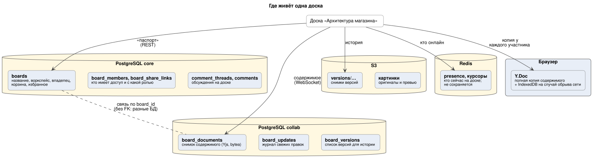
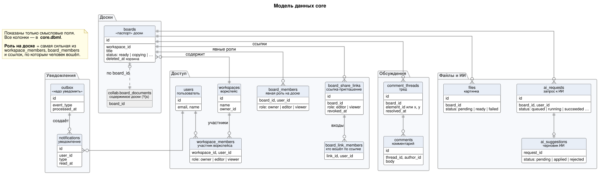
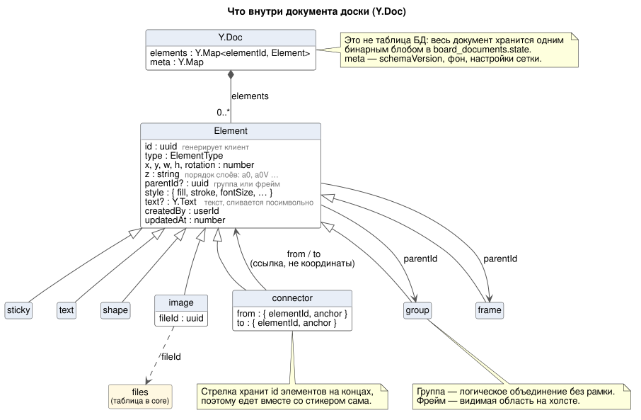

# Хранение данных: модель, объём, сервер, бэкапы

> Модель данных, сервер, надёжность и бэкапы. Масштаб — 1 000 DAU на одном VPS, нагрузка — [README §3](../README.md#3-нагрузка-сводка).

---

## 1. Какие хранилища и почему



| Хранилище | Что лежит | Почему именно оно |
|---|---|---|
| **PostgreSQL `core`** ([core.dbml](core.dbml)) | пользователи, сессии, воркспейсы, доски (метаданные), роли, ссылки-приглашения, комментарии, уведомления, outbox, ИИ-запросы, метаданные файлов, ключи идемпотентности | реляционные данные со связями и правами, нужны транзакции (например, «комментарий + запись в outbox» атомарно), поиск `pg_trgm`. Стек из ТЗ |
| **PostgreSQL `collab`** ([collab.dbml](collab.dbml)) | текущее состояние досок (Yjs-документ, `bytea`), лог правок (горячий буфер), метаданные версий | write-heavy, ключ доступа всегда `board_id`. Сейчас — отдельная схема в том же Postgres. При росте выносится в отдельный кластер, чтобы поток правок не мешал логину и каталогу, и шардируется по `board_id` |
| **Redis `realtime`** ([redis.md](redis.md)) | pub/sub между инстансами (socket.io adapter), presence, rate limit, кэш прав, ИИ-квоты | in-memory, TTL, атомарные `INCR`, pub/sub. Потеря данных допустима, поэтому здесь нет ничего, от чего зависит корректность: ключи идемпотентности живут в core (Р-38) |
| **Redis `queue`** ([redis.md](redis.md)) | очереди BullMQ | BullMQ требует `maxmemory-policy noeviction` и AOF. На одном VPS realtime и queue живут в одном Redis с `noeviction`, поэтому у всех ключей кэша и rate limit обязателен TTL. При росте разделяем на два Redis |
| **S3** (managed или MinIO) | изображения (оригинал + превью), снапшоты версий, аватары | большие неизменяемые блобы, дешёвые HDD. Бакет приватный: браузер получает файлы только по presigned URL (CDN — при росте) |

> **Почему не MongoDB для досок?** Документ доски для нас — **непрозрачный бинарный блоб Yjs**: мы его не запрашиваем по полям, только «дай по `board_id`» и «допиши правку». Под это одинаково подходит любое KV-хранилище. Postgres выбран, потому что он уже в стеке, есть транзакции (компакция атомарна) и не нужно сопровождать вторую СУБД.
> **Почему документ, а не таблица `elements`?** Строка на элемент выглядит «правильнее», но тогда конфликты, порядок и undo приходится решать вручную, а каждое перетаскивание становится UPDATE строки. С CRDT сервер хранит и пересылает обновления, а не интерпретирует их. Подробнее — [deep-dive §1](../deep-dive.md#1-как-синхронизировать-доску-crdt-yjs).

### ER-диаграммы

**core** — главные таблицы по областям (доступ, доски, обсуждения, файлы и ИИ, уведомления), их смысловые поля и связи. Возможные значения статусов и ролей записаны прямо в полях.



Схема нарисована вручную и показывает главное. Все колонки, индексы, служебные таблицы и пояснения к каждому полю — в [core.dbml](core.dbml): это источник правды. Меняешь таблицу — правь `core.dbml` и, если изменение заметное, `core-overview.puml`.

**collab** — три таблицы почти без связей между собой: `board_documents` (снимок документа), `board_updates` (журнал правок) и `board_versions` (версии), все по `board_id`. Отдельная ER-диаграмма тут ничего не добавляет: смотри [collab.dbml](collab.dbml) с пояснением к каждой колонке и [схему «Где живёт доска»](board-storage.svg). Связей с core нет: `board_id` ссылается на `boards.id` в другой схеме, целостность держит приложение.

## 2. Модель документа доски (внутри Yjs)

Это не таблица БД, а структура внутри `Y.Doc`. Описываем её, потому что от неё зависят конфликты и лимиты.



```ts
// Y.Doc
//  ├─ elements: Y.Map<elementId, Y.Map>   // ключ — uuid, сгенерированный клиентом
//  └─ meta:     Y.Map                     // schemaVersion (deep-dive §17), фон, настройки сетки
type Element = {
  id: string;            // uuid (клиент)
  type: 'sticky' | 'text' | 'shape' | 'image' | 'connector' | 'group' | 'frame';
  x: number; y: number; w: number; h: number; rotation: number;
  z: string;             // fractional index ("a0", "a0V"): конкурентная смена порядка без конфликтов
  parentId?: string;     // группа или фрейм
  style: { fill?: string; stroke?: string; fontSize?: number; ... };
  text?: Y.Text;         // форматированный текст: конкурентный ввод сливается посимвольно
  fileId?: string;       // для image: ссылка на files.id, сама картинка в S3
  // connector:
  from?: { elementId: string; anchor: 'auto' | 'top' | 'right' | 'bottom' | 'left' };
  to?:   { elementId: string; anchor: ... };
  createdBy: string; updatedAt: number;
};
```

- **Соединители хранят ссылки на элементы, а не координаты.** Геометрию линии считает клиент, поэтому при перемещении стикера стрелка «едет» сама, и обновлять соединитель не нужно (требование ТЗ).
- **Группа** — это элемент `type: 'group'`, а у детей есть `parentId`. Свои координаты и размеры у группы нулевые: рамку клиент считает по детям (схема проверки этого требует, [deep-dive §17](../deep-dive.md#17-проверка-содержимого-правок-и-версии-клиента)). Перемещение группы — одна транзакция, которая меняет `x`/`y` у всех детей, значит, это один шаг undo.

### Пример JSON: доска со всеми типами элементов

Так выглядит `doc.toJSON()` небольшой доски: фрейм «Бэкенд», в нём два стикера и стрелка между ними, рядом заголовок, фигура, картинка и группа. В самом `Y.Doc` элементы — это `Y.Map`, а текст — `Y.Text`; в JSON они превращаются в обычные объекты и строки. uuid сокращены для читаемости: в настоящих данных это полный uuid, сгенерированный клиентом.

```json
{
  "meta": { "schemaVersion": 1, "background": "#FFFFFF", "grid": true },
  "elements": {
    "f-1": {
      "id": "f-1", "type": "frame",
      "x": 0, "y": 0, "w": 800, "h": 500, "rotation": 0, "z": "a0",
      "style": { "fill": "#F5F5F5" },
      "text": "Бэкенд",
      "createdBy": "u-anna", "updatedAt": 1763030400000
    },
    "s-1": {
      "id": "s-1", "type": "sticky",
      "x": 60, "y": 80, "w": 200, "h": 200, "rotation": 0, "z": "a1",
      "parentId": "f-1",
      "style": { "fill": "#FFF59D", "fontSize": 16 },
      "text": "API",
      "createdBy": "u-anna", "updatedAt": 1763030401000
    },
    "s-2": {
      "id": "s-2", "type": "sticky",
      "x": 460, "y": 80, "w": 200, "h": 200, "rotation": 0, "z": "a2",
      "parentId": "f-1",
      "style": { "fill": "#C8E6C9", "fontSize": 16 },
      "text": "PostgreSQL",
      "createdBy": "u-boris", "updatedAt": 1763030402000
    },
    "c-1": {
      "id": "c-1", "type": "connector",
      "x": 0, "y": 0, "w": 0, "h": 0, "rotation": 0, "z": "a3",
      "parentId": "f-1",
      "style": { "stroke": "#424242", "endArrow": "arrow" },
      "from": { "elementId": "s-1", "anchor": "right" },
      "to":   { "elementId": "s-2", "anchor": "auto" },
      "createdBy": "u-anna", "updatedAt": 1763030403000
    },
    "t-1": {
      "id": "t-1", "type": "text",
      "x": 0, "y": -80, "w": 400, "h": 48, "rotation": 0, "z": "a4",
      "style": { "fontSize": 32 },
      "text": "Архитектура магазина",
      "createdBy": "u-anna", "updatedAt": 1763030404000
    },
    "sh-1": {
      "id": "sh-1", "type": "shape",
      "x": 900, "y": 80, "w": 160, "h": 100, "rotation": 15, "z": "a5",
      "shape": "ellipse",
      "style": { "fill": "#BBDEFB", "stroke": "#1E88E5" },
      "text": "Кэш",
      "createdBy": "u-boris", "updatedAt": 1763030405000
    },
    "i-1": {
      "id": "i-1", "type": "image",
      "x": 900, "y": 260, "w": 320, "h": 180, "rotation": 0, "z": "a6",
      "style": {},
      "fileId": "file-42",
      "createdBy": "u-boris", "updatedAt": 1763030406000
    },
    "g-1": {
      "id": "g-1", "type": "group",
      "x": 0, "y": 0, "w": 0, "h": 0, "rotation": 0, "z": "a7",
      "style": {},
      "createdBy": "u-anna", "updatedAt": 1763030407000
    },
    "sh-2": {
      "id": "sh-2", "type": "shape",
      "x": 0, "y": 560, "w": 200, "h": 120, "rotation": 0, "z": "a8",
      "parentId": "g-1", "shape": "rectangle",
      "style": { "fill": "#FFE0B2" },
      "text": "Очередь",
      "createdBy": "u-anna", "updatedAt": 1763030407000
    },
    "sh-3": {
      "id": "sh-3", "type": "shape",
      "x": 220, "y": 560, "w": 200, "h": 120, "rotation": 0, "z": "a9",
      "parentId": "g-1", "shape": "rectangle",
      "style": { "fill": "#FFE0B2" },
      "text": "Воркер",
      "createdBy": "u-anna", "updatedAt": 1763030407000
    }
  }
}
```

Что видно из примера:

- **Координаты абсолютные**, в системе координат холста, а не относительно родителя: поэтому перемещение группы меняет `x`/`y` у каждого ребёнка одной транзакцией.
- **У стрелки нет своей геометрии.** `from` и `to` ссылаются на элементы, линию рисует клиент. Поля `x`/`y`/`w`/`h` у неё не используются и равны 0: схема проверки ([deep-dive §17](../deep-dive.md#17-проверка-содержимого-правок-и-версии-клиента)) требует `w`, `h` > 0 у всех типов, кроме `connector` и `group`. Последнюю точку конца, если элемент удалили, документ не хранит ([deep-dive §2](../deep-dive.md#2-конфликты-что-происходит-в-спорных-случаях)).
- **Картинка** хранит только `fileId`. Адрес превью клиент получает через `GET /files/{id}`, а пока файл обрабатывается, рисует заглушку.
- **`z`** — строка для сортировки: элемент с большим `z` рисуется выше. Новый элемент между `a1` и `a2` получит, например, `a1V`.
- **Ключ в `elements` совпадает с `id`.** Удалить элемент — удалить ключ из карты и **в той же транзакции** удалить соединители, у которых `from.elementId` или `to.elementId` равен его `id`. Соединитель, о котором удаляющий клиент ещё не знал, удалит сервер починкой: сразу или, если документ открыт на нескольких инстансах, после их обмена state vector (до 60 с), чтобы не спутать «элемент удалён» с «элемент ещё не дошёл» ([deep-dive §17](../deep-dive.md#17-проверка-содержимого-правок-и-версии-клиента)).

### Открытые вопросы по модели

Пример показал места, где модель выше ничего не говорит. В JSON для них стоит **предлагаемый** вариант — утвердить на обсуждении контракта (#30) и после этого внести в тип `Element`:

1. **Вид фигуры.** Без отдельного поля не отличить прямоугольник от эллипса. Предложение: `shape: 'rectangle' | 'ellipse' | 'diamond' | 'triangle'`.
2. **Наконечники стрелки.** Линия и стрелка — один тип `connector` «со стилем» (глоссарий), но поля стиля для наконечников нет. Предложение: `style.startArrow` и `style.endArrow`: `'none' | 'arrow'`.
3. **Координаты группы и фрейма.** Хранить ли у `group` свои `x`/`y`/`w`/`h` или рамку считать по детям на клиенте. У фрейма рамка видимая и задаётся пользователем, у группы — нет. Предложение (оно же в примере выше и в схеме проверки): у `frame` хранить, у `group` считать по детям, а поля держать нулевыми.

## 3. Сервер

Всё работает на одном VPS в docker compose ([Р-44](../decisions.md#масштаб-и-инфраструктура)).

| Сервис | Сколько | Память (оценка) | Комментарий |
|---|---|---|---|
| nginx | 1 | ~50 МБ | TLS; `/` — статика фронтенда (сборка Vite), `/api` → `api`, `/collab/` → `collab` с board affinity по `boardId`; `files.<домен>` → MinIO (presigned POST и GET, сам доступ проверяет подпись) |
| `api` | 2 процесса | ~2 × 250 МБ | второй — требование ТЗ «несколько инстансов» |
| `collab` | 2 процесса | ~2 × 300 МБ | открытые документы в памяти: в пике ~70 досок × ~100 КБ — немного |
| `worker` | 1 процесс | ~400 МБ | sharp (картинки) и компакция через `Y.Doc` |
| PostgreSQL | 1 | ~1.5 ГБ | `shared_buffers` 1 ГБ: обе схемы целиком помещаются в память |
| Redis | 1 | ~100 МБ | `noeviction`, AOF `everysec` |
| MinIO | 1 | ~300 МБ | данные на диске VPS |
| Prometheus, Loki, promtail, Grafana, node_exporter, cAdvisor | | ~1.5 ГБ | метрики и логи храним 14 дней |
| **Итого** | | **~4.8 ГБ** | |

**Рекомендуемый VPS:** 4 vCPU, 8 ГБ RAM, NVMe от 200 ГБ.

**Диск:** базы данных маленькие (единицы гигабайт в год), место в основном занимают картинки в MinIO. Когда диск заполнен на 70% (алерт в Grafana), расширяем диск или переносим картинки во внешнее S3-хранилище.

**IOPS не ограничивают:** запись лога правок — ~15 пачек в секунду (≈ 30 IOPS), компакция и чтение — ещё несколько десятков. Любой SSD держит это с запасом в сотни раз.

> Оценка памяти — не замер. Проверяем нагрузочным тестом в прототипе (T0-07) и после запуска по метрикам cAdvisor.

## 4. Надёжность без реплик

Реплик и кластеров нет: при 1 000 DAU они дороже пользы ([README §2.5](../README.md#25-надёжность)). Что защищает данные:

| Что сломалось | Что происходит | Чем защищаемся |
|---|---|---|
| Упал процесс `collab` или `api` | клиенты переподключаются ко второму процессу, docker перезапускает упавший | `restart: unless-stopped`, healthcheck, два процесса каждой роли |
| Упал Postgres | правки идут между участниками, но не сохраняются; индикатор «сохраняется…» | collab буферизует правки в памяти и ретраит ([deep-dive §7](../deep-dive.md#7-персистентность-лог-правок-и-компакция)); docker перезапускает Postgres |
| Упал Redis | правки между процессами `collab` не ходят, курсоры пропали, очередь стоит | AOF для очереди, статусы задач в Postgres + reconciler; после возврата Redis серверы досинхронизируют документы ([Р-35](../decisions.md#синхронизация-доски)) |
| Перезагрузка VPS | недоступно несколько минут | compose поднимается сам, клиенты переподключаются, офлайн-правки остаются в браузере |
| VPS потерян целиком | недоступно до восстановления (~2 ч вручную) | бэкапы вне VPS (§6): новый сервер → `docker compose up` → восстановление БД и MinIO |

**Redis:** realtime-данные (presence, rate limit, кэш прав) терять можно, всё восстановится само. Очередь пишется в AOF `everysec`, поэтому теряется ≤ 1 с задач. Статус каждой задачи живёт в Postgres (`ai_requests.status`, `outbox`), а **reconciler** раз в минуту заново ставит «зависшие» задачи с тем же `jobId` — дубля не будет.

## 5. Если вырастем

Что меняется при росте ×10 и ×100 — таблица в [README §8](../README.md#8-как-будем-расти). Для данных к этому уже всё готово:

- **collab выносится в отдельный кластер:** это уже отдельная схема, и между схемами нет внешних ключей;
- **ключ шардирования collab — `board_id`:** все запросы collab идут по одной доске, cross-shard запросов нет. `board_updates` уже партиционирован `PARTITION BY HASH (board_id)` — это репетиция шардирования внутри одного узла;
- **core** при необходимости шардируется по `workspace_id`, но на вертикальном масштабировании проживёт очень долго;
- **реплики и failover** (Patroni для Postgres, Sentinel для Redis) понадобятся, когда простой в пару часов станет неприемлемым.

## 6. Бэкапы

- **PostgreSQL:** WAL-G (или pgBackRest). Полный бэкап раз в сутки и **непрерывный архив WAL** в объектное хранилище **у другого провайдера**, не на этом VPS → восстановление на любой момент, RPO ≤ 5 мин. Для этого `archive_timeout = 60s`: по умолчанию Postgres отправляет WAL в архив только по заполнении сегмента (16 МБ), и при низкой нагрузке неполный сегмент может лежать только на VPS дольше пяти минут. Цена — до 1 440 почти пустых сегментов в сутки, после сжатия это килобайты. Полные бэкапы и WAL храним 30 дней: дольше удалённые данные в бэкапе не живут.
- **MinIO:** `mc mirror --watch` непрерывно копирует новые объекты в то же внешнее хранилище, раз в сутки — полная сверка `mc mirror` без `--watch`. Отставание — минуты, как у архива WAL, поэтому восстановленная БД почти не ссылается на отсутствующие объекты. Если всё же ссылается (объект создан в последние минуты перед потерей VPS): картинка показывается заглушкой «файл недоступен», версия без снапшота — недоступной в истории; восстановление БД это не блокирует. В самом MinIO включён versioning, удалённое хранится 30 дней. Во внешней копии `mc mirror` работает без `--remove`, поэтому удалённые объекты там остаются: раз в сутки сверка удаляет из внешней копии объекты, которых нет в MinIO дольше 30 дней. Так окончательное удаление доски (корзина + 30 дней) доходит и до бэкапа не позже чем ещё через 30 дней.
- **Redis:** не бэкапим. Realtime восстанавливается сам, очередь — из AOF и reconciler.
- **Конфигурация:** compose-файлы и nginx-конфиг — в git, секреты — в GitHub Secrets. Новый сервер поднимается из репозитория.
- **Проверка:** раз в месяц восстанавливаем бэкап БД **и MinIO** на чистой машине и открываем доску с картинками и историей версий. Бэкап без проверки восстановления — не бэкап.
- **Правило 3-2-1:** 3 копии, 2 типа носителей, 1 копия вне основной площадки. Для нас: данные на VPS + внешнее хранилище + периодическая выгрузка дампа.

## 7. Кэширование

| Что | Где | TTL / инвалидация |
|---|---|---|
| Роль пользователя на доске | `socket.data.role` (на время соединения) + Redis `perm:{boardId}:{userId}` (для handshake и REST) | кэш 60 с + событие `perm:changed` через pub/sub (мгновенная инвалидация). Роли открытых сокетов дополнительно перепроверяются раз в 30 с запросом к core мимо кэша (Р-33, [deep-dive §6](../deep-dive.md#6-права-доступа-в-websocket)) |
| Документ открытой доски | память collab-инстанса (`Y.Doc`) | пока на доске есть люди + 60 с, потом сброс на диск и выгрузка |
| Статика фронтенда | кэш браузера (nginx ставит заголовки); CDN — при росте | имена с хешем → `Cache-Control: max-age=31536000, immutable` |
| Картинки и превью (приватные) | кэш браузера по presigned URL | подпись задаёт `response-cache-control: private, max-age=3600` — не дольше срока ссылки (1 ч). Долгий `immutable`-кэш нельзя: участник, потерявший доступ, видел бы превью из кэша, а на общем компьютере его увидел бы другой аккаунт |
| Каталог досок | не кэшируем | единицы RPS отлично держат индексы. Кэш добавил бы проблем с инвалидацией и не дал бы выигрыша |

## 8. Ключевые индексы

- `boards (workspace_id, updated_at DESC) WHERE deleted_at IS NULL` — каталог; частичный индекс, корзина не мешает.
- `boards (workspace_id, deleted_at) WHERE deleted_at IS NOT NULL` — корзина.
- `boards USING GIN (title gin_trgm_ops)` — поиск по подстроке `ILIKE '%арх%'`.
- `board_members (user_id)` — «доски, к которым у меня есть доступ».
- `board_share_links (token_hash) UNIQUE` — вход по ссылке.
- `board_link_members (board_id, user_id)` — роль по ссылкам при подсчёте итоговой роли; тот же запрос раз в 30 с перепроверяет роли открытых досок (~2 запроса/с при ~70 открытых досках, почти всё из `shared_buffers`).
- `idempotency_keys (user_id, key)` PK — повтор создающего POST; `created_at` — чистка старше 24 ч.
- `comment_threads (board_id, resolved_at)` — треды доски.
- `outbox (created_at) WHERE processed_at IS NULL` — релэй берёт только необработанные.
- `board_updates (board_id, seq)` PK — хвост лога для доски; `(board_id, update_hash) UNIQUE` — дедупликация.

Полный список — в [core.dbml](core.dbml) и [collab.dbml](collab.dbml).
