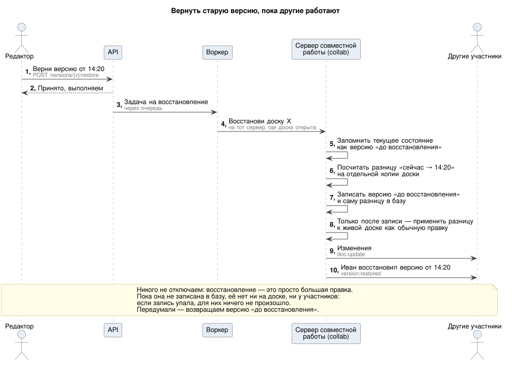
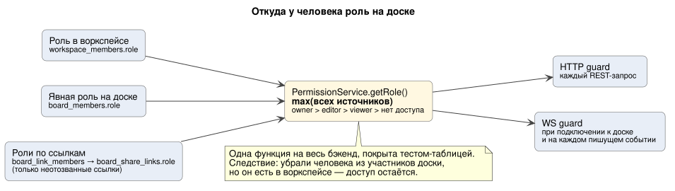

# Глубокое погружение

> Разделы 1–8 — сердце проекта: всё, что ТЗ называет «основной задачей». Разделы 9–14 — ИИ, лимиты, отказы, наблюдаемость и безопасность. Разделы 15–17 — что проверить прототипом, жизненный цикл сущностей, проверка содержимого правок и версии клиента.
> Термины — в [glossary.md](glossary.md).

---

## 1. Как синхронизировать доску: CRDT (Yjs)

ТЗ прямо предупреждает: «недостаточно просто отправлять всю доску по websocket после каждого изменения». Варианты:

| Подход | Как работает | Плюсы | Минусы |
|---|---|---|---|
| **Отправлять всю доску** | после каждой правки шлём JSON целиком | просто | 100 КБ на каждую правку: даже у нас (~46 правок/с в пике) это ~4.6 МБ/с вместо ~15 КБ/с. И последний записавший затирает остальных |
| **Сервер — арбитр, LWW по элементу** | клиент шлёт операцию `{opId, elementId, field, value, baseVersion}`, сервер присваивает `seq`, разрешает конфликт «последний победил» по полю | понятно, легко валидировать на сервере, хорошо учит бэкенду | вручную: порядок (`seq`), дыры при реконнекте, undo (обратные операции), офлайн, текст (два человека печатают в один стикер) |
| **OT** (Operational Transformation, как в Google Docs) | сервер трансформирует конкурентные операции друг относительно друга | зрелый подход для текста | сложная математика, нужен центральный сервер. Для графики почти не применяется |
| **CRDT (Yjs)** ✅ | каждая реплика — структура данных, которая математически сходится при любом порядке применения обновлений | порядок не важен, дубли не страшны, офлайн бесплатно, текст сливается посимвольно, `UndoManager` из коробки, готовые биндинги к socket.io/IndexedDB | бинарный формат (сервер «не видит» операций без декодирования); документ копит метаданные удалений; строгая серверная валидация сложнее |

**Почему CRDT для нашего проекта:** ТЗ требует сразу всё, что CRDT даёт из коробки: конкурентные правки, «удалил ↔ редактирует», переподключение, повторную доставку и undo «только своих». Писать это вручную — несколько месяцев работы всей команды. Бэкенду всё равно остаётся много: права, персистентность, компакция, версии, масштабирование между инстансами, лимиты.

> Альтернатива. Если команда хочет «потрогать руками» серверный порядок операций, можно сделать op-log с LWW для **геометрии** (x, y, w, h, цвет), а Yjs оставить только для **текста** внутри стикеров. Это сложнее и рискованнее, но полезнее для понимания. Решать на этапе прототипа.

### Как работает Yjs в пяти фактах

1. У каждого клиента свой `Y.Doc` — полноценная копия документа. Правки применяются **локально и мгновенно** (оптимистичный UI).
2. Каждая правка порождает **update** — маленький бинарный дифф (`Uint8Array`, десятки–сотни байт).
3. Updates **коммутативны** (порядок не важен) и **идемпотентны** (повторное применение ничего не меняет).
4. **State vector** — компактная сводка «что у меня уже есть» (по счётчику на каждого автора). По чужому state vector можно вычислить ровно недостающее: `Y.encodeStateAsUpdate(doc, remoteSV)`.
5. Updates можно склеивать без загрузки документа: `Y.mergeUpdates([...])`. На этом построена батч-запись. Удалённое содержимое так не убирается, поэтому компакция загружает документ в `Y.Doc` (§7).

### Серверная часть (NestJS, упрощённо)

```ts
@WebSocketGateway({ namespace: '/collab', transports: ['websocket'], maxHttpBufferSize: 1e6 })
export class CollabGateway {
  constructor(
    private readonly docs: YDocRegistry,       // Y.Doc в памяти по boardId
    private readonly buffer: UpdateBuffer,     // батч-запись в board_updates раз в 1 с
    private readonly limits: SocketRateLimiter,
  ) {}

  @UseGuards(WsBoardRoleGuard)                 // роль из socket.data.role ≥ editor, иначе FORBIDDEN
  @RequireRole('editor')
  @SubscribeMessage('doc:update')
  async onUpdate(@ConnectedSocket() s: Socket, @MessageBody() { update }: { update: Uint8Array }) {
    if (!this.limits.take(s, 'doc', 30)) return { ok: false, code: 'RATE_LIMITED' };
    const boardId: string = s.data.boardId;
    const doc = await this.docs.get(boardId);

    // Y.applyUpdate + id затронутых элементов, включая вложенные поля и текст (observeDeep, §17);
    // origin — чтобы не разослать правку обратно автору
    const { changed, changedIds } = this.docs.apply(doc, update, { socketId: s.id });
    if (!changed) return { ok: true, n: this.buffer.lastSeq(s) }; // полный повтор: ничего не изменилось — не рассылаем и не пишем

    const repair = this.validator.check(doc, changedIds);    // схема, циклы, жёсткий лимит элементов (§17)

    s.to(`board:${boardId}`).emit('doc:update', { update }); // остальным; на других инстансах — через Redis adapter
    this.docs.publishToPeers(boardId, update);               // серверным Y.Doc на других инстансах
    const n = this.buffer.add(boardId, update, s);           // в БД — пачкой; n — номер правки на этом сокете.
                                                             // После коммита пачки сокет получит doc:saved {upTo: n} (Р-32)
    if (repair) {                                            // сервер чинит своей правкой, её получают все, включая автора
      this.docs.broadcastServerUpdate(boardId, repair.update);
      return { ok: false, n, code: 'INVALID_ELEMENT', elementIds: repair.elementIds };
    }

    if (this.docs.elementCount(boardId) > SOFT_LIMIT) {
      return { ok: true, n, warning: 'ELEMENT_LIMIT' };       // мягкий лимит, см. §10
    }
    return { ok: true, n };                                    // ack = «принято», а не «сохранено» (Р-32)
  }
}
```

## 2. Конфликты: что происходит в спорных случаях

ТЗ: «продумайте, что будет, если два человека одновременно меняют один элемент, один удаляет элемент, который редактирует другой…».

| Ситуация | Что сделает Yjs | Наше продуктовое решение |
|---|---|---|
| A и B одновременно меняют **разные поля** одного стикера (A — цвет, B — позицию) | сольются оба изменения | ✅ то, что нужно. Поэтому элемент — это `Y.Map` полей, а не одно JSON-значение |
| A и B одновременно меняют **одно поле** (оба тянут стикер) | детерминированно выигрывает одна запись, одинаково у всех | приемлемо. Чтобы реже сталкиваться, в awareness показываем «B держит этот элемент» (мягкая блокировка: подсветка рамкой, без запрета) |
| A и B **печатают в один стикер** | `Y.Text` сливает текст посимвольно, как в Google Docs | ✅ |
| A **удаляет** стикер, B в это время **редактирует** его | удаление ключа из `elements` побеждает, правки B уходят в удалённый объект | по умолчанию согласны (как Miro). У B элемент исчезнет с тостом «элемент удалил A». Вернуть его может A (своим undo) или любой редактор через историю версий |
| A двигает **группу**, B двигает **элемент внутри** | обе записи `x`/`y` у ребёнка, побеждает одна | приемлемо. Проблема чисто визуальная, через 100 мс видно итог |
| A кладёт группу 1 в группу 2, а B **в то же время** кладёт группу 2 в группу 1 | оба `parentId` применятся, получится **цикл**: 1 → 2 → 1 | Figma отклоняет такую правку на сервере, с CRDT отклонить её нельзя (Р-29). Правило на клиенте: при обходе дерева цикл разрывается детерминированно — элемент цикла с наименьшим `id` считается лежащим на корне холста. Сервер после применения правки ищет циклы среди изменённых элементов и чинит их той же правкой: обнуляет `parentId` у этого элемента ([§17](#17-проверка-содержимого-правок-и-версии-клиента)). Глубина вложенности — не больше 10 |
| A удаляет элемент, к которому B **проводит стрелку** | соединитель ссылается на несуществующий `elementId` | клиент рисует «висящий» конец в последней известной точке. Очистку таких связей делает тот, кто удалил, в той же транзакции: удаляет и прикреплённые соединители |
| A и B одновременно меняют **порядок слоёв** | `z` — дробный индекс (строка между соседями), конфликт редкий, итог детерминированный | ✅ |
| A восстанавливает **версию**, B в этот момент редактирует | восстановление — обычная правка, правки B сливаются с ней по тем же правилам | правка B сохранится, если не конфликтует с восстановлением. Если восстановление удаляет элемент, который правит B, побеждает удаление (Р-13). §5 |

## 3. Undo/redo и история версий — разные функции

| | **Undo/redo** | **История версий** |
|---|---|---|
| Что отменяет | **свои** последние действия | состояние всей доски на момент T |
| Где живёт | в браузере, `Y.UndoManager` | на сервере: снапшоты в S3 + `board_versions` |
| Кто видит | только я | все участники |
| Время жизни | до закрытия вкладки | 30 дней все, далее 1 в день, именованные навсегда |
| Затрагивает чужие правки | **нет** | да, вся доска |

**Как undo отменяет только своё:**

```ts
const undo = new Y.UndoManager(doc.getMap('elements'), {
  trackedOrigins: new Set([LOCAL_ORIGIN]), // только транзакции, сделанные этим клиентом
  captureTimeout: 500,                     // правки ближе 500 мс друг к другу — один шаг (перетаскивание)
});
doc.transact(() => moveSelection(dx, dy), LOCAL_ORIGIN);
undo.undo(); // откатит перемещение, даже если B после этого менял другие элементы
```

Удалённые обновления применяются с другим origin (провайдер), и `UndoManager` их не отслеживает. Если B изменил тот же элемент после меня, undo вернёт **моё** изменение, но не тронет поля, которые менял B.

> 🖥 Это целиком фронтенд-задача, но бэкенду важно одно: **сервер никогда не должен вносить изменения от имени пользователя**. Иначе пользователь не сможет их отменить. Поэтому ИИ-черновик применяет клиент (§9).

## 4. Несколько инстансов: Redis adapter и board affinity

**Проблема:** A подключён к инстансу 1, B — к инстансу 2. `io.to(room).emit()` на инстансе 1 по умолчанию знает только свои сокеты.

**Решение по ТЗ:** `@socket.io/redis-adapter`. Каждый `emit` в комнату публикуется в Redis, остальные инстансы получают его и отправляют своим сокетам. Это даёт корректность.

**Проблема при росте:** у нас ~500 курсоров/с на два процесса, Redis этого не заметит. Но при 100 000 DAU курсоров было бы ~50 000/с, и если каждый идёт через Redis на 8 процессов — 400 000 доставок/с, причём большинство процессов выбросит сообщение, потому что у них нет сокетов этой комнаты. Ниже — как к этому готовимся, не усложняя текущий код.

**Оптимизация — board affinity:** балансировщик выбирает инстанс по `boardId` (consistent hashing: `hash $arg_boardId consistent;` в nginx). Тогда все участники доски почти всегда на **одном** инстансе, и копия `Y.Doc` тоже одна. Consistent hashing нужен, чтобы при добавлении или падении инстанса переехала только 1/N досок, а не все.

> ⚠️ **Affinity не убирает трафик через Redis.** Обычный Redis adapter публикует в Redis **каждый** `io.to(room).emit()`, даже если все адресаты сидят на этом же инстансе. Он не знает, где сокеты комнаты. Каждый инстанс получает публикацию и выбрасывает её, если своих сокетов комнаты у него нет. Affinity экономит CPU и память (одна копия документа), но не Redis.
>
> Сейчас берём **обычный адаптер** (Р-44): при 1 000 DAU это сотни публикаций в секунду. При росте до десятков тысяч DAU переходим на **шардированный адаптер** (`createShardedAdapter`, Redis 7 sharded pub/sub, `subscriptionMode: 'dynamic'`): у каждой комнаты свой канал, и процесс подписан только на комнаты, где у него есть сокеты. Это замена одной строки в инициализации, код шлюза не меняется.

| При 100 000 DAU, 8 процессов | Обычный adapter | Шардированный adapter + board affinity |
|---|---|---|
| Корректность между инстансами | ✅ | ✅ |
| Нагрузка на Redis | ~55 000 публикаций/с, каждая доставляется всем 8 инстансам ≈ 440 000 доставок/с | те же ~55 000 публикаций/с, но 1–2 доставки на каждую |
| Серверный `Y.Doc` | копия на каждом инстансе, где есть участник доски | обычно одна копия |
| «Горячая» доска (400 человек) | размазана по инстансам | вся на одном инстансе, поэтому нужны лимиты |
| Сложность | минимальная | настройка LB + тест «а если affinity сломалась» |

**Как делают другие.** Figma, tldraw и, судя по докладу 2022 года, Miro держат каждый документ в **одном** процессе, и все участники подключаются к нему. tldraw прямо предупреждает: если комнат две, участники перезапишут правки друг друга. Figma, чтобы в документ писал ровно один процесс, завела таблицу блокировок и проверку владельца на каждой записи в журнал. У нас CRDT, поэтому две копии документа не портят данные: ошибка маршрутизации стоит лишних ресурсов, но не потери правок. Это наше преимущество, но не повод держать копии постоянно. Hocuspocus с Redis честно предупреждает, что каждое сообщение обрабатывают все инстансы и Redis не снижает нагрузку на CPU.

> **Решение (Р-25, заменяет Р-10):** board affinity — **основной режим**. Несколько копий документа — нормальное, но временное состояние: во время деплоя, после падения инстанса, при изменении числа инстансов. Redis adapter и канал `collab:doc:{boardId}` остаются обязательными: они дают корректность в эти моменты.
>
> **Для пет-проекта:** affinity включаем с первого деплоя на 2 инстанса, это одна строка в nginx. Тест из ТЗ «пользователи на разных инстансах видят друг друга» проверяем отдельно: ws-тест подключает клиентов **напрямую** к разным инстансам, в обход балансировщика (AC-4.2).

**Серверные копии документа.** Adapter доставляет события **клиентам**, но не серверному `Y.Doc` на другом инстансе. Если на инстансе 2 тоже открыт этот документ (потому что там сидит B), инстанс 1 публикует правку в канал `collab:doc:{boardId}`, на который инстанс 2 подписан, пока держит документ. Благодаря CRDT неважно, в каком порядке инстансы получат правки: копии сойдутся.

**Кто пишет в БД:** каждый инстанс пишет только правки **от своих клиентов**. Дублей нет, а если ретрай записи всё-таки повторится, `update_hash UNIQUE` → `ON CONFLICT DO NOTHING`.

**Подписка — до загрузки.** Инстанс, который открывает документ, сначала подписывается на `collab:doc:{boardId}` и копит приходящие правки, потом читает документ из БД (§7) и применяет накопленное. Иначе правка соседа, опубликованная между чтением и подпиской, до этой копии не дойдёт.

**Досинхронизация после разрыва Redis (Р-35).** Pub/Sub не хранит сообщения: всё, что опубликовали, пока Redis был недоступен, пропало. Браузеры при этом остаются подключены к своим инстансам и сами не переподключаются, поэтому `sync:step1` клиента ничего не исправит. CRDT сходится, только если каждая копия получила все правки. Поэтому серверные копии досинхронизируются между собой тем же протоколом, что клиент с сервером:

1. Инстанс снова подключился к Redis. Для каждого открытого документа он публикует в `collab:doc:{boardId}` запрос `{type: 'sync', from, stateVector}`.
2. Каждый инстанс, у которого открыт этот документ, отвечает диффом `Y.encodeStateAsUpdate(doc, stateVector)`, адресованным `from`.
3. Получатель применяет дифф к своей копии и рассылает **своим** клиентам то, чего у них не было, обычным `doc:update`.

Запрос шлют все инстансы, поэтому обмен идёт в обе стороны. Источник — живые копии в памяти, а не БД: в БД может не быть правок из буфера соседа, который ещё не записан. Страховка от потерянного ответа: раз в 60 с такой же обмен идёт для документов, открытых на нескольких инстансах (это видно по `instanceId` в `presence:{boardId}`). Таких документов обычно единицы. После переподключения к Redis инстанс заодно сразу перепроверяет роли (§6).

## 5. Восстановление версии, пока другие работают

ТЗ: «продумайте, что происходит, если в этот момент другие участники работают на доске».

| Вариант | Как | Минусы |
|---|---|---|
| Жёсткая замена | остановить доску, заменить документ, переподключить всех | все теряют несохранённые локальные правки и офлайн-изменения, появляются «прыжки» |
| ✅ **Восстановление как новая правка** | вычислить минимальную разницу «текущее → старое» и применить одной транзакцией | правки, сделанные параллельно, сливаются с ним. Восстановленное состояние не «чистое», если кто-то правил в ту же секунду, и это честно |

**Где выполняется (Р-37).** Не в воркере по данным из БД, а в **collab-инстансе, который держит документ**. В БД может не быть правок последней секунды (они в буфере). Если считать разницу по БД, версия `pre_restore` получится неполной, а элементы, созданные в эту секунду, восстановление не уберёт.

Цепочка такая. `api` ставит джобу `restore-{requestId}`. Воркер вызывает внутренний эндпоинт collab через внутренний listener балансировщика с тем же хешем по `boardId`, что и у WebSocket, поэтому запрос попадает на инстанс доски. Если документ нигде не открыт, инстанс загрузит его сам (§7). Дальше на этом инстансе:

1. В транзакции collab DB берётся `pg_try_advisory_xact_lock` по `boardId`. Не взялась → `409`: восстановление уже идёт. Блокировка живёт ровно столько, сколько транзакция, поэтому запоздавший процесс не может писать «после истечения», как с TTL-блокировкой в Redis.
2. Буфер правок этой доски сбрасывается в лог.
3. Загружается снапшот выбранной версии из S3.
4. Снимок текущего документа `Y.encodeStateAsUpdate(doc)` сохраняется как версия `pre_restore`.
5. **Синхронно**, в одном куске кода без `await`, вызывается `restoreTo(doc, version)`. Node однопоточный: между вычислением разницы и её применением чужая правка не влезет, и приём правок останавливать не нужно.
6. Обновление восстановления пишется в `board_updates` в той же транзакции, что и блокировка. Затем — рассылка в комнату, `collab:doc`, событие `version:restored`.

Повтор джобы с тем же `requestId` безопасен: если `pre_restore` с этим `restore_request_id` уже есть, второй не создаётся, а если восстановление уже записано (`restore_applied_at`), джоба просто выходит.



<sub>Упрощённая схема. [Подробная версия](sequences/detailed/07-version-restore.svg) — со всеми проверками, ошибками и SQL.</sub>

```ts
/** Минимальный дифф: меняем только то, что отличается, чтобы меньше конфликтовать с параллельными правками. */
function restoreTo(current: Y.Doc, versionUpdate: Uint8Array, origin = 'restore') {
  const old = new Y.Doc();
  Y.applyUpdate(old, versionUpdate);
  const cur = current.getMap<Y.Map<unknown>>('elements');
  const prev = old.getMap<Y.Map<unknown>>('elements');

  current.transact(() => {
    for (const id of [...cur.keys()]) if (!prev.has(id)) cur.delete(id);          // появились после версии → удалить
    for (const [id, oldEl] of prev) {
      const curEl = cur.get(id);
      if (!curEl) { cur.set(id, cloneElement(oldEl)); continue; }                // удалённые после версии → вернуть
      for (const [key, value] of oldEl) if (!equalField(curEl.get(key), value)) setField(curEl, key, value);
      for (const key of [...curEl.keys()]) if (!oldEl.has(key)) curEl.delete(key);
    }
  }, origin);
}
```

**Гарантии и честные ограничения:**

- перед восстановлением сохраняется версия `pre_restore`, поэтому «откатить восстановление» = восстановить её. В неё не попадут только правки, пришедшие между шагами 4 и 5 (доли секунды) и ещё не дошедшие до этого инстанса (с другой копии документа или из офлайна). Они сливаются как параллельные;
- параллельная правка **не обязательно сохранится** в итоге: если восстановление удаляет элемент, который кто-то сейчас правит, побеждает удаление (Р-13). Если оба меняют одно поле, выигрывает одна из записей. CRDT гарантирует, что у всех будет одинаковый результат, а не то, что победит чьё-то намерение. Офлайн-правки, которые придут позже, сливаются так же;
- участники получают `version:restored {by}`, и UI показывает «Иван восстановил версию от 14:20»;
- два одновременных восстановления одной доски запрещены: `409` через advisory lock в collab DB (шаг 1).

## 6. Права доступа в WebSocket

ТЗ: «проверка прав доступа не только в HTTP запросах, но и в websocket событиях».

1. **Handshake:** JWT → `userId`; `PermissionService.getRole(userId, boardId)` → `socket.data.role`; `none` → отказ. Сокет вступает в комнаты `board:{boardId}`, `user:{userId}` и `board:{boardId}:user:{userId}` (последняя — для точечного отключения).
2. **Каждое пишущее событие:** guard сверяет `socket.data.role` с требуемой ролью (`doc:update` → editor). **Не доверяем ничему от клиента:** роль никогда не приходит в payload.
3. **Изменение прав на лету:**
   - `api` после коммита публикует `perm:changed {boardId, userId}`;
   - collab-инстансы пересчитывают роль сокетов этого пользователя **на этой доске**: понижение → `board:permission-changed`, отзыв → `board:kicked` + отключение.
   - Отключение — через комнату пересечения, в namespace шлюза:

     ```ts
     // this.server — @WebSocketServer() шлюза, то есть namespace /collab, а не корневой io
     this.server.in(`board:${boardId}:user:${userId}`).disconnectSockets(true); // работает между инстансами через adapter
     ```

     > ⚠️ **Нельзя** `io.in('user:X').in('board:Y')`: несколько `in()`/`to()` в socket.io — это **объединение** комнат, а не пересечение. 🖥 Как CSS-селектор `.user-X, .board-Y` вместо `.user-X.board-Y`. Такой вызов отключил бы всю доску Y и пользователя X на всех его досках.
4. **Страховка от потерянного `perm:changed` (Р-33).** Pub/sub может потерять сообщение, а viewer ничего не пишет, поэтому проверка «при следующем пишущем событии» его никогда не отключит. Поэтому:
   - **раз в 30 с** инстанс перепроверяет роли всех сокетов каждой открытой доски **одним запросом на доску** к primary core, мимо Redis-кэша. При ~70 открытых досках в пике это ~2 лёгких запроса в секунду по индексу;
   - **сразу после переподключения к Redis** — внеочередная перепроверка всех досок: пока Redis не было, события могли потеряться;
   - при `auth:refresh` роль тоже пересчитывается;
   - **если core недоступна**, сокеты остаются с последней известной ролью (fail-open, §11). Это безопасно: пока core лежит, отозвать доступ невозможно, потому что отзыв — это транзакция в core. Риск остаётся только для отзыва, который закоммитили прямо перед падением, если его событие потерялось. Такой отзыв сработает на первой перепроверке после возвращения core.

   Итоговое обещание: отзыв доступа срабатывает **< 5 с**, если событие дошло, и **≤ 30 с**, если потерялось (README §2.3).
5. **Истёкший токен:** access-токен живёт 15 мин, а соединение может жить часами. Клиент шлёт `auth:refresh` с новым токеном. Если не прислал за 1 мин после истечения — отключаем. «Выйти на всех устройствах» → `session_revoked` → kick.
6. **Viewer:** получает `doc:update` и шлёт `awareness` (его курсор видно), но любой `doc:update` от него → `FORBIDDEN`. Даже модифицированный клиент ничего не изменит.



Итоговая роль: `max(роль в воркспейсе, явная роль на доске, роли по действующим ссылкам)` (источники хранятся раздельно, Р-42, §16). Это одна функция в одном сервисе, её покрываем unit-тестами по таблице всех комбинаций.

## 7. Персистентность: лог правок и компакция

**Запись:** collab копит updates по доске в памяти и раз в 1 с пишет одной строкой: `Y.mergeUpdates(batch)` → `INSERT INTO board_updates ... ON CONFLICT (board_id, update_hash) DO NOTHING`. Так из ~46 правок/с в пике получается ~15 INSERT/с ([database/README §4](database/README.md#3-сервер)).

- `update_hash` защищает только от **повтора записи той же пачки** (ретрай `INSERT`). Повторная правка от клиента попала бы в другую пачку с другим хешем. Поэтому полные повторы отсекаются раньше: если `Y.applyUpdate` ничего не изменил (в транзакции пустые `changed` и `deleteSet`), правка не рассылается и не попадает в буфер.
- После коммита пачки каждый сокет, чьи правки в ней были, получает `doc:saved {upTo: n}` (Р-32, [websocket.md §4.2](api/websocket.md#42-правка)). Это и есть граница «сохранено». ack раньше означает только «принято и разослано».

**Компакция** (джоба `compaction`, дедупликация BullMQ по id `compact-{boardId}` с `keepLastIfActive`: пока задача ждёт, вторая не создаётся; если правки пришли, пока задача выполнялась, после неё будет ровно одна повторная. Завершённые задачи компакции не храним). Схема — [sequences/06-compaction.svg](sequences/06-compaction.svg):

```sql
BEGIN;
SELECT state FROM board_documents WHERE board_id = $1 FOR UPDATE;      -- одна компакция на доску
SELECT seq, update FROM board_updates WHERE board_id = $1;             -- всё, что есть сейчас
-- в коде: doc = new Y.Doc(); applyUpdate(doc, state); updates.forEach(u => applyUpdate(doc, u));
--         state' = Y.encodeStateAsUpdate(doc)   -- именно через Y.Doc, см. ниже
UPDATE board_documents SET state = $state', ... WHERE board_id = $1;
DELETE FROM board_updates WHERE board_id = $1 AND seq = ANY($read_seqs); -- ровно прочитанные строки
COMMIT;
```

> ⚠️ **Ловушка:** удалять `WHERE seq <= max_seq` и загружать `WHERE seq > compacted_seq` **нельзя**. Две транзакции могут получить seq 10 и 11, а закоммититься в обратном порядке. Компакция увидит 11, удалит `≤ 11`, а 10 появится позже и будет «ниже границы» — правка потеряна. Поэтому удаляем ровно прочитанные строки, а загружаем снапшот + **все** оставшиеся строки. Если какая-то строка влита и всё равно применится повторно, это безопасно: CRDT идемпотентен. Это классическая проблема «видимости по порядку id» в транзакционных БД.

> ⚠️ **Почему через `Y.Doc`, а не `Y.mergeUpdates` (Р-26).** `Y.mergeUpdates` склеивает updates без загрузки документа, это быстро. Но документация Yjs прямо говорит: так удалённое содержимое **не убирается**, для этого документ нужно загрузить в `Y.Doc`. Если компакция только склеивает, то стикер, созданный и удалённый тысячу раз, навсегда остаётся в снапшоте, и со временем любая активная доска упрётся в лимит 10 МБ. Загрузка в `Y.Doc` с включённым garbage collection (по умолчанию) превращает удалённое содержимое в компактные метки. Это дороже по CPU, поэтому:
> - `Y.mergeUpdates` используем там, где нужна скорость: склейка буфера перед `INSERT` раз в 1 с;
> - компакция всегда идёт через `Y.Doc`, конкурентность очереди ограничена (4 на процесс).

**Проверка компакции.** Figma, прежде чем включить свой журнал, прогнала ~400 тыс. проверок «снапшот + журнал дают тот же файл байт в байт». У нас дешевле, но с двумя ловушками:

- **State vector не годится как отпечаток содержимого.** Он считает только вставки, а удаление новых записей не создаёт. Две копии с одинаковым state vector могут отличаться удалениями. 🖥 Как сравнивать массивы по `.length`. Сравниваем `Y.snapshot(doc)`: в нём и state vector, и множество удалений (`Y.equalSnapshots`).
- **Живой документ меняется**, поэтому сравнивать его «как есть» с БД нельзя: будут ложные тревоги. Нужна общая граница.

Порядок проверки: (1) в момент T берём `mem = Y.encodeStateAsUpdate(doc)` у документа в памяти; (2) ждём 2 с, чтобы все инстансы сбросили то, что было у них к моменту T; (3) читаем документ из БД согласованным чтением (см. «Загрузка» ниже) в `dbDoc`; (4) применяем `mem` к копии `dbDoc`. Если `Y.equalSnapshots` до и после различаются, в БД нет чего-то, что было в памяти: метрика `collab_compaction_mismatch_total` и алерт. Проверяем выборочно (≈1% компакций): `encodeStateAsUpdate` на большой доске недешёвый. Это ловит потерю правок раньше пользователей.

**Компакция при деплое.** До перехода на журнал у Figma каждый деплой закрывал все документы и вызывал волну записей. Наш drain при остановке сбрасывает только буфер правок в лог, а компакцию не запускает. Компакции, которые ставятся при выгрузке документа, получают случайную задержку 0–5 мин (`delay` в BullMQ). Тогда тысячи досок не компактируются в одну и ту же секунду после релиза.

**Загрузка документа (Р-34):** `state` + все оставшиеся строки лога → `Y.applyUpdate` по очереди (порядок не важен). Важно, **как** читать:

> ⚠️ **Два отдельных SELECT могут увидеть разные моменты.** В Postgres по умолчанию (Read Committed) каждый запрос видит свой снимок данных. Возможна такая последовательность: загрузчик прочитал старый `state` → компакция закоммитила новый `state` и удалила влитые строки → загрузчик читает лог и получает пустой хвост. Документ соберётся без правок, которые были в удалённых строках. Сама БД при этом цела, но копия в памяти, версия, `pre_restore`, копия доски и контекст ИИ, собранные из такого чтения, будут неполными, а версия и копия сохранятся навсегда. Чтение с primary эту гонку не убирает. 🖥 Это «tearing», как в concurrent React: два куска состояния прочитаны в разные моменты.

Поэтому есть **один общий загрузчик** `DocumentLoader` для collab, версий, восстановления, копирования и ИИ: оба SELECT идут в одной read-only транзакции `REPEATABLE READ`, где все запросы видят один снимок. Либо всё читается одним SQL-запросом. Collab перед чтением подписывается на `collab:doc:{boardId}` и копит приходящие правки (§4).

**Если collab DB недоступна:** буфер растёт в памяти (до 50 МБ на инстанс), клиенты продолжают работать, ретраи идут с backoff. `doc:saved` в это время не приходит, и UI честно показывает «не сохранено». Если инстанс упадёт, у сервера пропадёт весь несохранённый буфер, а не только последняя секунда: правки останутся у клиентов (память, IndexedDB) и вернутся при их переподключении. Буфер переполнен → `server:degraded {read_only}` для новых правок. Подробнее — §11.

**Альтернатива — Redis Streams** как горячий лог (`XADD board:{id}`), а Postgres только для снапшотов. Снимает запись лога с Postgres, но добавляет риск потери при падении Redis (≤ 1 с при AOF `everysec`; клиенты дошлют своё при реконнекте) и второе место, где живут данные доски. Для нас Postgres проще и с огромным запасом; Streams имеет смысл рассматривать только на очень большом масштабе.

**Версии:** джоба `versions` (jobId = `ver-{boardId}-{30-минутный бакет}`, то есть не чаще раза в 30 мин; если в этом бакете auto-версия уже есть в `board_versions`, джоба выходит) собирает документ общим загрузчиком и пишет `versions/{boardId}/{versionId}.bin` в S3 и строку в `board_versions`. Плюс версия, когда уходит последний участник. Ежедневная джоба прореживает auto-версии старше 30 дней до одной в день.

## 8. Идемпотентность и повторная доставка

ТЗ: «повторная доставка одного и того же события не должна создавать дубли элементов или повторно применять изменение».

| Где может прийти дубль | Защита |
|---|---|
| `doc:update` повторён (ретрай, реконнект, два пути доставки) | Yjs-updates идемпотентны: повторное применение — no-op. ID элементов генерирует клиент, тот же uuid — тот же ключ. Полный повтор сервер распознаёт (применение ничего не изменило) и не пишет в лог (§7) |
| Запись пачки в БД повторена | `UNIQUE (board_id, update_hash)` + `ON CONFLICT DO NOTHING` |
| `POST` создания (доска, воркспейс, приглашение, ИИ, копирование, восстановление) | заголовок `Idempotency-Key` → таблица `idempotency_keys` в core, запись **в той же транзакции**, что и само создание (Р-38). Подробнее — ниже |
| Тред и комментарий | id генерирует клиент → `INSERT ... ON CONFLICT (id) DO NOTHING` |
| Джоба BullMQ поставлена дважды | детерминированный `jobId` (`ai-{requestId}`, `tg-{notificationId}`, `copy-{requestId}`) — BullMQ не создаст дубль, пока задача хранится в Redis. В jobId **нет двоеточий**: BullMQ их запрещает. Для компакции — встроенная дедупликация (§7) |
| Джоба выполнилась, но упала до подтверждения → выполнится снова | обработчики идемпотентны: проверяют статус (`ai_requests.status = succeeded` → выход), отправка в Telegram проверяет `telegram_sent_at` |
| Outbox-релэй прочитал запись дважды | `FOR UPDATE SKIP LOCKED`; уведомления создаются с `UNIQUE (outbox_id, user_id)` (§16) |

**Как работает `Idempotency-Key` (Р-38).** Первым действием в транзакции создания выполняется `INSERT INTO idempotency_keys (user_id, key, operation, request_hash) ...`, в конце той же транзакции туда пишется ответ. Что это даёт:

- **Двойной клик** (два одновременных запроса): второй `INSERT` ждёт на уникальном индексе, пока первая транзакция закоммитится, затем получает конфликт и возвращает сохранённый ответ. Резервировать ключ отдельно не нужно.
- **Ответ потерялся в сети**, клиент повторил запрос через минуту: в таблице тот же ответ, ресурс не создаётся второй раз.
- **Транзакция упала:** строка с ключом откатилась вместе с ней, и повтор выполнит создание заново. Так и должно быть.
- **Тот же ключ, другое тело запроса** (`request_hash` не совпал) → `422 IDEMPOTENCY_KEY_REUSED`.

Почему не Redis: realtime-Redis вытесняет ключи (`allkeys-lru`) и не персистентен, а запись в него не атомарна с коммитом в Postgres. Потеря ключа превратила бы повтор в новое создание. Строки старше 24 ч чистит `maintenance`.
| Telegram `sendMessage` (API не идемпотентен) | `telegram_sent_at` ставим сразу после успешного ответа. Остаётся окно «отправили, но не успели записать» → редкий дубль. Принимаем: at-least-once для уведомлений лучше, чем at-most-once |

## 9. ИИ внутри продукта

ТЗ: «не нужно просто добавлять чат сбоку от доски. ИИ должен уметь работать с содержимым доски».

**Сценарии:**

- `generate_diagram`: «интернет-магазин на микросервисах» → блоки и стрелки;
- `brainstorm`: тема → 10–15 стикеров-идей;
- `cluster`: выделенные стикеры → группы с заголовками (фреймы);
- `summarize`: выделенное → стикер-резюме;
- `expand`: «чего не хватает в этой схеме?» → новые блоки рядом.

**Конвейер:** [architecture/README §3.4](architecture/README.md#34-ии-сгенерируй-архитектуру-интернет-магазина). Ключевые решения:

1. **Только асинхронно (BullMQ):** запрос идёт 5–30 с, держать HTTP-соединение нельзя. Прогресс приходит по WS.
2. **Контекст — компактный текст, а не Yjs-бинарь:** worker превращает выделение в `[{id, type, text, x, y, groupId}]`, обрезает тексты и ограничивает 200 элементами / ~8 000 токенов.
3. **Structured output:** просим модель вернуть JSON по схеме и валидируем zod. Невалидный ответ → один ретрай с сообщением об ошибке → иначе `failed`.

   ```ts
   const Diagram = z.object({
     nodes: z.array(z.object({ tempId: z.string(), kind: z.enum(['sticky', 'shape', 'text', 'frame']),
                               text: z.string().max(300), color: z.string().optional(),
                               parentTempId: z.string().nullable().optional() })).max(60),
     edges: z.array(z.object({ from: z.string(), to: z.string(), label: z.string().max(60).optional() })).max(120),
   });
   ```

4. **Координаты считаем не моделью:** LLM плохо считает геометрию. Модель возвращает граф, раскладку делает **elkjs/dagre** на воркере.
5. **Превью → применить/отклонить:** черновик хранится отдельно (`ai_suggestions`) и в документ не попадает, пока пользователь не нажал «Применить». Применяет клиент одной транзакцией, поэтому это его действие, отменяемое Ctrl+Z (§3).
6. **Деньги:** ~1.75 млн токенов в день ([README §3](README.md#3-нагрузка-сводка)). Немного, но случайный цикл может сжечь месячный бюджет за час, поэтому квоты и лимит расходов у провайдера обязательны.
   - квоты: 20 в день, 3 в минуту;
   - лимит контекста;
   - кэш ответов не нужен: запросы уникальны;
   - метрика стоимости в Grafana;
   - при сбое задачи квота возвращается.
7. **Отказоустойчивость:**
   - таймаут 60 с;
   - 2 ретрая с backoff только на 429/5xx;
   - **circuit breaker**: при > 50% ошибок за минуту быстро отвечаем «ИИ временно недоступен», а не копим очередь;
   - провайдер настраивается через env: пакет `openai` работает с любым OpenAI-совместимым API.
8. **Prompt injection:** содержимое доски — недоверенные данные (кто-то может написать на стикере «игнорируй инструкции»). Поэтому:
   - данные идут в отдельном блоке с разделителями;
   - ответ жёстко валидируется схемой;
   - у модели нет инструментов и доступа к другим доскам;
   - худшее, что она может сделать, — предложить странный черновик, который пользователь отклонит.

## 10. Лимиты и защита от перегрузки

ТЗ: «продумайте ограничения на размер файлов, количество элементов и запросы к ИИ». Таблица лимитов — в [README §2.2](README.md#22-лимиты), здесь — как они реализованы.

| Уровень | Механизм |
|---|---|
| Балансировщик | лимит соединений на IP, `limit_req` на `/auth/*` |
| REST | `@nestjs/throttler` + Redis storage (общий счётчик на все инстансы) |
| WS-события | token bucket **в памяти процесса** (сокет живёт на одном инстансе, Redis на каждый курсор не нужен) |
| Размер WS-сообщения | `maxHttpBufferSize` = 1 МБ. Сообщение больше лимита socket.io не отклоняет ошибкой, а **рвёт соединение**. Поэтому большой дифф (после долгого офлайна) клиент сам передаёт кусками `sync:chunk` (Р-36, [websocket.md §4.3](api/websocket.md#43-переподключение-обрыв-сети-сон-ноутбука-упал-инстанс)) |
| Элементы на доске | **мягкий** лимит: после применения update считаем `elements.size`. Превышен 10 000 → предупреждение, 20 000 → `ELEMENT_LIMIT` и отказ в дальнейших вставках (проверяем дифф: растёт ли `size`). Строгая проверка **до** применения требует декодировать update (`Y.decodeUpdate`) — дороже, это компромисс выбора CRDT |
| Размер документа | `size_bytes` при компакции: > 10 МБ → доска только для чтения + уведомление владельцу |
| Файлы | условие `content-length-range` в presigned POST (S3 сам отклонит файл больше лимита) + проверка в воркере |
| ИИ | квоты в Redis (`INCR` с TTL), concurrency воркера, circuit breaker |
| Деградация | при CPU collab > 80% → `server:degraded {cursors_reduced}`: клиенты шлют курсоры с частотой 5 Гц вместо 10 |

## 11. Отказы: что будет, если упадёт X

Всё работает на одном VPS ([Р-44](decisions.md#масштаб-и-инфраструктура)): у `api` и `collab` по два процесса, но Postgres, Redis и MinIO — в одном экземпляре. Реплик нет, поэтому падение хранилища — это простой до перезапуска, а не переключение на реплику.

| Компонент | Что видит пользователь | Как переживаем |
|---|---|---|
| **процесс collab** | на 1–3 с «переподключение…», потом всё на месте | клиенты переподключаются (backoff + jitter) ко второму процессу, `sync:step1` досылает недостающее в обе стороны. Несохранённые правки (без `doc:saved`) есть у клиентов: у автора в памяти и IndexedDB, у остальных — если рассылка до них дошла. Docker перезапускает упавший процесс |
| **процесс api** | ничего (второй процесс) | healthcheck в nginx, stateless |
| **Redis** | правки между участниками на **разных** процессах не видны, пока Redis не вернётся; курсоры пропали; ИИ, картинки и уведомления задерживаются | docker перезапускает Redis за секунды. С affinity участники доски обычно на одном процессе, и у них правки идут как обычно: своим сокетам adapter рассылает и без Redis. Пропущенное за время разрыва Pub/Sub не воспроизводит: после переподключения серверные копии обмениваются state vector (§4, Р-35), а роли перепроверяются (§6). Очередь восстанавливается из AOF; статус задач в Postgres, reconciler заново ставит зависшие с тем же `jobId`. Rate limit — **fail-open** (лучше пропустить лишнее, чем заблокировать всех), ИИ-квоты — **fail-closed** (деньги) |
| **Postgres** | «сохраняется…» без «сохранено»: правки идут между участниками, но не сохраняются; нельзя войти, открыть каталог, комментировать | docker перезапускает Postgres. Уже открытые доски продолжают работать: роль закэширована в сокете, документ — в памяти collab. collab буферизует правки и ретраит; при переполнении буфера — read-only |
| **MinIO** | картинки не грузятся (плейсхолдеры), загрузка недоступна | версии ставятся в очередь с ретраями. Доска как документ от S3 не зависит |
| **LLM-провайдер** | «ИИ временно недоступен», квота не списана | circuit breaker, таймауты, квота возвращается |
| **Telegram** | уведомления в TG опоздают, in-app работают | ретраи с backoff и уважением `retry_after` |
| **VPS целиком** | сервис недоступен (перезагрузка — минуты, потеря сервера — ~2 ч) | после перезагрузки compose поднимается сам. Потеря сервера — восстановление из бэкапов вне VPS, RPO ≤ 5 мин ([database §4, §6](database/README.md#4-надёжность-без-реплик)). Офлайн-правки пользователей остаются в браузере и досылаются после восстановления |
| **Лавина реконнектов** (упал процесс со всеми сокетами) | — | jitter на клиенте; загрузка документов ограничена семафором (не больше 50 параллельно) |

## 12. Observability

ТЗ требует в проде Loki + promtail, Prometheus + node_exporter + cAdvisor и Grafana.

**Метрики (prom-client, `/metrics` на каждом процессе):**

| Группа | Метрики |
|---|---|
| REST (RED) | `http_requests_total{route,status}`, `http_request_duration_seconds{route}` (histogram) |
| WebSocket | `ws_connections` (gauge), `ws_joins_total`, `ws_messages_total{event,direction}`, `ws_message_bytes` (histogram), `ws_rejected_total{reason}` (forbidden, rate_limited, too_large), `ws_reconnects_total` |
| Collab | `collab_docs_in_memory`, `collab_doc_size_bytes` (histogram), `collab_broadcast_lag_seconds` (получили → разослали), `collab_unpersisted_bytes`, `collab_persist_batch_duration_seconds`, `collab_compaction_lag_seconds` |
| Очереди | `bullmq_jobs{queue,state}` (waiting/active/failed/delayed), `bullmq_job_duration_seconds{queue}` |
| ИИ | `ai_requests_total{kind,status}`, `ai_latency_seconds`, `ai_tokens_total{direction}`, `ai_cost_estimate`, `ai_quota_rejected_total` |
| Бизнес | активные доски, созданные доски в день, DAU (из логов входа) |
| Инфраструктура | node_exporter (CPU, RAM, диск, сеть), cAdvisor (контейнеры), postgres_exporter (connections, replication lag, slow queries), redis_exporter |

**Логи (pino → stdout → promtail → Loki):**

- только JSON с `requestId`, `userId`, `boardId`, `socketId`, `instanceId`;
- **не логируем** курсоры и каждую правку (90% трафика и мусор), содержимое досок и комментариев, токены и пароли;
- логируем joins/leaves, ошибки, отказы в правах, медленные запросы.

**Алерты:**

- доля 5xx > 1% за 5 мин;
- p99 REST > 300 мс или `collab_broadcast_lag` p99 > 200 мс;
- replication lag > 10 с;
- `collab_unpersisted_bytes` растёт 2 мин подряд;
- `bullmq waiting{queue="ai"}` > 200;
- `failed` джоб > 5% за 10 мин;
- диск > 80%;
- ошибки LLM > 20%.

**SLO:** 99.9% успешных REST-запросов; 99% правок доставлены другим участникам < 200 мс.

> Трейсинг (OpenTelemetry + Tempo) ТЗ не требует, но для цепочки «REST → очередь → воркер → WS-событие» он очень помогает. Хорошее «⭐ задание».

## 13. Безопасность

- **Пароли:** argon2id.
- **Токены:**
  - refresh — в httpOnly + Secure + SameSite=Lax cookie с ротацией и обнаружением повторного использования (кража → отзыв всей семьи). Ротацию вводим в вехе 3, до неё refresh без ротации (Р-60);
  - access — 15 мин, в памяти фронта (не в localStorage).
- **CSRF:** для эндпоинта с cookie (`/auth/refresh`) проверяем `Origin` + SameSite. Остальные запросы идут с Bearer-токеном, поэтому CSRF к ним неприменим.
- **WebSocket:** проверка `Origin` (cross-site WebSocket hijacking), авторизация на handshake и на событиях (§6).
- **IDOR:** каждый запрос проверяет, что ресурс принадлежит доске или воркспейсу с доступом. Например, `PATCH /threads/{id}` загружает тред → его `board_id` → роль. Нет доступа → `404`, а не `403`.
- **Токены ссылок:** 128 бит случайности, в БД только sha256, отзыв мгновенный.
- **Файлы:**
  - проверка по magic bytes, а не по расширению;
  - **SVG запрещён** (в нём бывает `<script>`);
  - EXIF вырезаем (геолокация с фото);
  - приватный бакет, presigned URL с коротким сроком.
- **Секреты:** `.env` только локально, в CI/CD — GitHub Secrets, в репозитории только `.env.example`.
- **ПДн и 152-ФЗ:** если продукт публичный и пользователи из РФ, персональные данные хранятся на серверах в РФ. Это влияет на выбор облака и LLM-провайдера, которому уходят тексты с досок.

## 14. 🖥 Фронтенд-угол: что бэкенду нужно знать о клиенте

> Подробно для фронта — [frontend.md](frontend.md): схема состояния, жизненный цикл страницы доски, индикатор сохранения, ошибки, авторизация.

ТЗ: «состояние интерфейса, содержимое доски и данные с сервера должны иметь понятные зоны ответственности».

| Состояние | Где на клиенте | Откуда |
|---|---|---|
| UI (выбранный инструмент, открытые панели, зум, выделение) | **Zustand** | только клиент |
| Содержимое доски | **Y.Doc** (+ подписки рендера на изменённые элементы) | WS `doc:*` |
| Курсоры других | отдельный слой (canvas/overlay), **вне React-дерева** или с точечными подписками | WS `awareness:*` |
| Данные сервера (каталог, треды, версии, профиль) | **TanStack Query** | REST + инвалидация по WS-событиям (`comments:changed` → `invalidateQueries`) |

Отсюда требования к бэкенду:

1. **WS-события-инвалидации** (`comments:changed`, `version:created`) несут только id, без данных. Данные клиент перезапросит через REST: один источник правды, нет рассинхрона кэшей.
2. **Курсоры приходят частыми мелкими сообщениями.** ТЗ: «перемещение курсора одного участника не должно вызывать перерисовку всего приложения». Это решает фронт, а бэк не должен склеивать курсоры с правками документа в одно событие.
3. **ID генерирует клиент:** оптимистичный UI без ожидания сервера.

## 15. Что проверить прототипом до основной разработки

ТЗ: «до начала основной разработки проверить выбранную библиотеку холста и подход к совместному редактированию на небольшом прототипе». Чек-лист для бэкенда (те же проверки в формате «Дано / Когда / Тогда» — истории 4–7, 9, 10, AC-3.5, AC-3.6 и AC-8.5–8.7 в [acceptance.md](acceptance.md)):

- [ ] Yjs + socket.io (свой провайдер или `y-socket.io`) + **2 инстанса** + Redis adapter: правка с инстанса 1 видна на инстансе 2.
- [ ] Два клиента тянут один стикер → сходятся к одному состоянию.
- [ ] Undo отменяет только своё (вместе с фронтом).
- [ ] Обрыв сети на 30 с с правками у обоих → после реконнекта документы равны.
- [ ] Повторная отправка того же update → нет дублей.
- [ ] Viewer не может изменить документ даже модифицированным клиентом.
- [ ] Документ на 5 000 элементов: размер, время загрузки, память сервера.
- [ ] Нагрузочный замер: сколько msg/s держит один процесс → пересчёт хостов.
- [ ] Компакция под нагрузкой: правки не теряются (тест на гонку из §7); после 1 000 циклов «создать и удалить стикер» размер снапшота не растёт (§7, Р-26).
- [ ] Компакция **между двумя чтениями загрузчика** (тестовая пауза после чтения снапшота): документ совпадает с эталоном (Р-34).
- [ ] Разрыв **только Redis** при двух инстансах с открытыми сокетами: правим разные элементы, возвращаем Redis без переподключения браузеров → все копии сошлись (Р-35).
- [ ] Офлайн-дифф больше 1 МБ при документе меньше 10 МБ доходит кусками, в том числе с обрывом посреди передачи (Р-36).
- [ ] Отзыв доступа при потерянном `perm:changed`: viewer без исходящих сообщений перестаёт получать правки ≤ 30 с (Р-33).
- [ ] `doc:saved` получен → collab убит `kill -9` → доска в чистом браузере содержит правку (Р-32).
- [ ] Восстановление версии одновременно с перемещением, вводом текста, удалением и возвращением офлайн-клиента; затем восстановление `pre_restore` (Р-37).
- [ ] **Горячая доска** отдельно от средних цифр: 100 редакторов + 300 зрителей на одной доске — fan-out, исходящий трафик, память `Y.Doc`, время проверки по схеме, задержка event loop. Средние сообщения/с число серверов не доказывают.
- [ ] Сколько участников реально выдерживает одна доска. tldraw оценивает свою комнату примерно в 50 одновременных участников, а наш лимит — 100 редакторов и 300 зрителей (Р-23).
- [ ] Невалидный элемент от модифицированного клиента не ломает доску у остальных (§17).
- [ ] **План Б:** поднять тот же сценарий на Hocuspocus и сравнить объём своего кода и поведение (Р-31).

Для фронтенда прототип холста должен ответить не только «рисует ли библиотека стикер», но и на вопросы, от которых зависит выбор: пространственный индекс и hit-testing на 5 000 элементов, отрисовка только видимой области (viewport culling), трансформация групп, жизненный цикл редактирования текста поверх `Y.Text`, границы одного шага undo при перетаскивании, загрузка большой доски.

---

## 16. Жизненный цикл сущностей (автоматы состояний)

У нескольких сущностей есть статус, который меняют разные процессы: `api`, `worker`, расписание. Если не расписать, какие переходы допустимы, появляются баги вида «запрос отменили, а черновик всё равно пришёл» или «файл навсегда завис в `pending`».

🖥 Это как `status: 'pending' | 'error' | 'success'` в TanStack Query. Только статус хранится в БД, и поменять его одновременно пытаются несколько процессов.

### Общие правила

1. **Переход — один `UPDATE` с проверкой текущего статуса** (compare-and-set). Так два воркера или воркер и отмена от пользователя не перезапишут друг друга:

   ```sql
   UPDATE ai_requests SET status = 'running', started_at = now()
   WHERE id = $1 AND status = 'queued'
   RETURNING id;   -- 0 строк → запрос уже взял другой воркер или его отменили: выходим, ничего не делая
   ```

2. **У каждого промежуточного статуса есть таймаут и тот, кто его разбирает.** Сам по себе таймаут ничего не делает: зависшую запись найдёт только reconciler из очереди `maintenance` ([redis.md](database/redis.md#queue-bullmq)). Без него `queued` может висеть вечно.
3. **Финальные статусы не меняются.** Повторный запрос с тем же финальным результатом — `204` (идемпотентно), запрос с другим результатом — `409`.
4. **Не каждому сроку нужен статус и джоба.** «Ссылка истекла» — это условие `expires_at < now()` при чтении, а не статус, который кто-то должен проставить.
5. **Изменение статуса, которое ждёт пользователь, сопровождается WS-событием.** Если событие потерялось, клиент узнаёт результат через `GET`.

### Запрос к ИИ (`ai_requests.status`)

```
queued ──▶ running ──▶ succeeded
  │           ├──────▶ failed
  └───────────┴──────▶ cancelled
```

| Переход | Кто | Когда | Что ещё происходит |
|---|---|---|---|
| — → `queued` | api | `POST /boards/{id}/ai/requests` | квота списана (`INCR`), джоба `ai-{requestId}` поставлена |
| `queued` → `running` | worker | взял джобу (CAS из правила 1) | `ai:progress` |
| `running` → `succeeded` | worker | ответ модели прошёл zod-схему | в той же транзакции создаётся `ai_suggestions(pending)`; затем `ai:done` |
| `running` → `failed` | worker | ошибка после ретраев, невалидный ответ, circuit breaker | квота возвращается; `ai:done {failed}` |
| `queued`/`running` → `cancelled` | api | `DELETE /ai/requests/{id}` | квота возвращается. Если воркер уже работает, при записи результата его CAS (`WHERE status = 'running'`) вернёт 0 строк, и черновик не сохранится |
| `queued` → `failed` | reconciler | в `queued` больше 10 мин: джоба потерялась | квота возвращается. Через 2 мин reconciler сначала пробует поставить джобу заново с тем же `jobId` |
| `running` → `failed` | reconciler | в `running` больше 3 мин: воркер упал посреди работы | квота возвращается |

### Черновик ИИ (`ai_suggestions.status`)

```
pending ──▶ applied
   ├──────▶ rejected
   └──────▶ expired
```

| Переход | Кто | Когда | Что ещё происходит |
|---|---|---|---|
| — → `pending` | worker | вместе с `ai_requests → succeeded` | |
| `pending` → `applied` / `rejected` | api | `POST /ai/requests/{id}/decision`, только автор запроса | повтор того же решения — `204`, другое решение — `409` |
| `pending` → `expired` | maintenance | старше 24 ч | |

> Статус `applied` сообщает клиент, и сервер не может его проверить: сами элементы приходят в документ обычным `doc:update` (Р-9). Поэтому статус черновика нужен только для аналитики качества ИИ и для `expired`. На права и содержимое доски он не влияет.

### Файл (`files.status`)

```
pending ──▶ processing ──▶ ready
   │             └───────▶ failed
   └──▶ (удалён)
```

| Переход | Кто | Когда | Что ещё происходит |
|---|---|---|---|
| — → `pending` | api | `POST /boards/{id}/files` | выдан presigned POST на 10 МБ |
| `pending` → `processing` | api | `POST /files/{id}/complete` и объект действительно есть в S3 (`HeadObject`) | джоба `img-{fileId}` |
| `processing` → `ready` | worker | magic bytes совпали, sharp сделал превью | `file:ready` |
| `processing` → `failed` | worker | не картинка, битый файл, ошибка после 3 ретраев | объект удаляется из S3; `file:failed`, клиент показывает на месте элемента «не удалось загрузить» |
| `pending` → удалён | maintenance | `complete` не пришёл за 1 ч | запись и объект удаляются |

> Если элемент-картинку удалили с доски, файл остаётся до окончательного удаления доски. Отслеживать ссылки из Yjs-документа на каждый файл дорого, а лишние мегабайты на одной доске — небольшая цена.

### Доска: корзина (`boards.deleted_at`)

```
активна ──▶ в корзине ──▶ purging ──▶ (удалена окончательно)
   ▲            │
   └────────────┘ restore
```

| Переход | Кто | Когда | Что ещё происходит |
|---|---|---|---|
| активна → в корзине | api, только owner | `DELETE /boards/{id}` | `deleted_at = now()`, `purge_after = +30 дней`; участники получают `board:kicked {board_deleted}`; ссылки-приглашения перестают работать (проверка по `deleted_at`) |
| в корзине → активна | api, только owner | `POST /boards/{id}/restore` до `purge_after` | CAS: `UPDATE boards SET deleted_at = NULL, purge_after = NULL WHERE id = $1 AND deleted_at IS NOT NULL AND status <> 'purging'`. 0 строк, потому что удаление уже началось → `410`. Права участников не трогали, поэтому они просто снова могут войти |
| в корзине → `purging` | maintenance (раз в час) или owner через `DELETE /boards/{id}/permanent` | `purge_after` прошёл или owner решил сам | **первым шагом** CAS `status = 'purging'`: после этого restore невозможен, а фоновые джобы (версии, компакция, копирование) видят статус и выходят |
| `purging` → удалена | worker | | удаляются документ и лог правок в collab, версии и файлы в S3, затем строка в core. Последним шагом перед строкой ещё раз удаляется префикс доски в S3: на случай версии, которую записала запоздавшая джоба. Каждый шаг терпит «уже удалено», поэтому джобу можно безопасно перезапустить |

### Доска: копирование (`boards.status`)

```
copying ──▶ ready
   └─────▶ copy_failed
```

| Переход | Кто | Когда | Что ещё происходит |
|---|---|---|---|
| — → `copying` | api | `POST /boards/{id}/copy` | создаётся доска-заготовка, джоба `copy-{requestId}`; ответ `202`. Документ-источник читается общим загрузчиком (§7) |
| `copying` → `ready` | worker | документ, версии и файлы скопированы | `board:copy-done {ready}` |
| `copying` → `copy_failed` | worker или reconciler | ошибка после 3 ретраев или висит в `copying` больше 10 мин | `board:copy-done {copy_failed}`; в каталоге «не удалось скопировать», заготовку можно удалить |

> Пока статус `copying`, доску нельзя открыть на редактирование: collab отвечает на подключение отказом, иначе правки смешаются с копируемым документом.

### Приглашения и ссылки — без статуса

У `workspace_invites` и `board_share_links` нет колонки статуса: состояние вычисляется при чтении.

| Состояние | Условие |
|---|---|
| действует | `revoked_at IS NULL` и (`expires_at IS NULL` или `expires_at > now()`), у приглашения ещё и `accepted_at IS NULL` |
| принято | `accepted_at IS NOT NULL` (только приглашение в воркспейс) |
| отозвано | `revoked_at IS NOT NULL` |
| истекло | `expires_at <= now()` |

**Откуда у человека доступ (Р-42).** Источников может быть несколько сразу: роль в воркспейсе, явная роль на доске (`board_members`) и одна или несколько ссылок (`board_link_members`: кто по какой ссылке вошёл). Роль по ссылке действует, пока ссылка не отозвана. Срок `expires_at` закрывает только **новые** входы, а тех, кто уже вошёл, не выкидывает. Отзыв ссылки — это `revoked_at = now()`: строки других источников не трогаем, поэтому явная роль и вход по второй ссылке сохраняются. После коммита публикуется `perm:changed`, и тех, у кого не осталось ни одного источника, отключает от доски (`board:kicked {access_revoked}`), а у кого роль понизилась — переводит в просмотр.

Следствие правила «самая сильная роль» (Р-14): если убрать человека из участников доски, но у него есть роль в воркспейсе, доступ останется. Интерфейс управления доступом должен это показывать: «доступ через воркспейс».

### Outbox

Раньше `processed_at` означал «джоба поставлена в очередь». Но Redis queue может потерять задачу после этого (AOF `everysec`, асинхронная реплика), и тогда уведомление пропадает без следа: outbox считает его отправленным. Поэтому (Р-41) in-app уведомление релэй создаёт **сам, в своей транзакции**, без очереди: это просто `INSERT`. В очередь уходит только отправка в Telegram, а её состояние живёт в самой строке уведомления.

| Состояние | Условие | Кто меняет |
|---|---|---|
| ждёт обработки | `processed_at IS NULL` | relay в worker берёт пачку через `FOR UPDATE SKIP LOCKED` и в той же транзакции создаёт `notifications` (`UNIQUE (outbox_id, user_id)`) и ставит `processed_at` |
| обработано | `processed_at IS NOT NULL` | relay. Значит, in-app уведомления уже в БД, а не «где-то в очереди» |
| застряло | `processed_at IS NULL` и `attempts >= 10` | никто: алерт «outbox stuck», разбираем руками |

Telegram: после коммита релэй ставит джобы `tg-{notificationId}` для уведомлений с `telegram_required`. Reconciler раз в минуту ищет `telegram_required AND telegram_sent_at IS NULL AND created_at < now() - 5 мин` и ставит их заново с тем же jobId.

## 17. Проверка содержимого правок и версии клиента

### Проблема

Сервер применяет любой Yjs-update, если у автора роль editor и не превышены размер и частота. Но содержимое правки он не смотрит. Модифицированный или просто кривой клиент может записать элемент с `type: 'foo'`, `x: "abc"` или текстом на мегабайт, и у остальных участников упадёт рендер.

tldraw прямо предупреждает: без серверной схемы «в базу попадут плохие данные». Figma проверяет правки на сервере, например отклоняет те, что создают цикл во вложенности. У CRDT здесь своя сложность: **применённый update нельзя «отменить»**, а разобрать его до применения дорого (`Y.decodeUpdate` даёт низкоуровневую структуру, а не элементы).

### Решение (Р-27): применить → проверить изменённое → починить

1. **Одна схема элемента для фронта и бэка.** zod-схема в пакете `contracts`: discriminated union по `type` ([модель элемента](database/README.md#2-модель-документа-доски-внутри-yjs)). Ограничения: координаты — конечные числа в пределах ±10⁷; `w` и `h` больше 0 и не больше 10⁵; текст до 10 000 символов; цвет по регулярному выражению; у соединителя есть `from` и `to`.
2. **Проверяем только изменённые элементы, включая вложенные изменения.** Элемент — это вложенная `Y.Map`, текст — `Y.Text`. Обычная правка (`element.set('x', …)`, ввод текста) меняет **вложенный** тип, а набор ключей верхней карты `elements` не трогает. Поэтому смотреть только на `changed` для `elements` нельзя: так пропустятся почти все правки. Собираем id через глубокое наблюдение:

   ```ts
   elements.observeDeep((events) => {
     for (const e of events) {
       if (e.target === elements) e.keysChanged.forEach((id) => changedIds.add(id)); // добавили или удалили элемент
       else changedIds.add(e.path[0] as string);                                     // правка внутри элемента: путь начинается с его id
     }
   });
   ```

   Найденные элементы прогоняем через `ElementSchema.safeParse`. Это микросекунды, а не проверка всей доски на каждую правку. В этом же месте проверяем циклы во вложенности (поднимаемся по `parentId` не выше 10 уровней, [§2](#2-конфликты-что-происходит-в-спорных-случаях)) и жёсткий лимит элементов ([§10](#10-лимиты-и-защита-от-перегрузки)).
   - **Остальной документ тоже граница доверия.** Карта `meta` проверяется своей схемой. Поле `meta.schemaVersion` меняет только сервер: правку клиента сервер откатывает своей правкой. Корневые типы, кроме `elements` и `meta`, клиенту создавать нельзя: такие правки дают `INVALID_UPDATE`, а содержимое сервер очищает.
3. **Невалидное сервер чинит своей правкой**, с origin `server-repair`:
   - то, что можно поправить, поправляет: обрезает текст, приводит координаты в допустимый диапазон, обнуляет `parentId` у элемента из цикла;
   - то, что поправить нельзя (неизвестный `type`, нет обязательных полей), удаляет;
   - правку-починку получают все, включая автора; автору в ack уходит `INVALID_ELEMENT` с id элементов.
4. **Повторные нарушения — отключение.** Счётчик на сокете: 3 невалидные правки за минуту → `board:kicked`, запись в лог и метрика `collab_invalid_updates_total`. Обычный клиент сюда не попадает: он проверяет элементы той же схемой до отправки.
5. **Клиент рисует защитно.** Элемент, не прошедший схему, не рисуется, а ошибка уходит в Sentry. Такой элемент может оказаться в документе на время до починки сервером или из старых данных.

Ограничение подхода: между применением и починкой невалидный элемент на долю секунды попадает к остальным. Поэтому пункт 5 обязателен, а не «на всякий случай».

### Версии клиента и схемы (Р-28)

Модель элемента будет меняться: новые типы, новые поля. В какой-то момент у части пользователей открыта вкладка со старым фронтом. У tldraw для этого у каждой фигуры есть схема и миграции, а при несовместимости клиент видит «обновите страницу».

| Что | Как |
|---|---|
| **Версия протокола в handshake** | клиент шлёт `auth: { token, protocolVersion }`. У сервера есть `MIN_PROTOCOL_VERSION`: клиент ниже → `connect_error {code: 'UPGRADE_REQUIRED'}`, и фронт показывает «обновите страницу». Версию повышаем только при несовместимом изменении |
| **Версия схемы документа** | `meta.schemaVersion` в `Y.Doc` |
| **Правила изменения модели** | поля только добавляем, и они необязательные. Старый клиент не трогает незнакомые поля: в `Y.Map` он меняет только те ключи, которые знает. Незнакомый тип элемента старый клиент рисует заглушкой «обновите приложение» и не удаляет. Переименовать поле или поменять его смысл = добавить новое поле и миграцию |
| **Миграция документа** | при загрузке доски в collab: если `meta.schemaVersion` меньше текущей, сервер применяет миграцию своей правкой (`server-repair`) и пишет её в лог как обычный update. Доски мигрируют лениво, по мере открытия |
| **Порядок деплоя** | сначала бэкенд, который понимает старую и новую версии, потом фронт. Так же советует tldraw |

## Источники: как это сделано у других

Что взяли и что сверили с этими материалами — в §2, §4, §7 и §17.

| Источник | Что оттуда важно для нас |
|---|---|
| [How Figma's multiplayer technology works](https://www.figma.com/blog/how-figmas-multiplayer-technology-works/) (2019) | процесс на документ; LWW по свойствам с порядком от сервера; ID от клиента ради офлайна; циклы во вложенности; дробный индекс; комментарии и права — отдельная система |
| [Making multiplayer more reliable](https://www.figma.com/blog/making-multiplayer-more-reliable/) (Figma, 2022) | журнал с номерами + снапшоты; потеря «до 60 с» до журнала; волна записей при деплое; блокировка, чтобы писал один процесс; проверка восстановления байт в байт |
| [Behind the feature: autosave](https://www.figma.com/blog/behind-the-feature-autosave/) (Figma, 2020) | офлайн-правки в IndexedDB; почему не сериализовать документ целиком |
| [tldraw sync](https://tldraw.dev/docs/sync), [tldraw-sync-cloudflare](https://github.com/tldraw/tldraw-sync-cloudflare) | одна комната на документ, иначе правки перезаписываются; схема и миграции на сервере; ~50 участников на комнату; картинки не через сокет; read-only и отдельные права на комментарии |
| [Yjs: document updates](https://docs.yjs.dev/api/document-updates) | `mergeUpdates` не убирает удалённое — нужен `Y.Doc` |
| [Hocuspocus](https://tiptap.dev/docs/hocuspocus/getting-started/overview), [Redis extension](https://tiptap.dev/docs/hocuspocus/server/extensions/redis), [hooks](https://tiptap.dev/docs/hocuspocus/server/hooks) | готовый Yjs-сервер: хуки авторизации, read-only, сохранение с задержкой 2 с / не реже 10 с; с Redis каждое сообщение обрабатывают все инстансы |
| [yjs/yhub](https://github.com/yjs/yhub) (бывший y-redis) | серверы без документа в памяти, Redis streams, воркер компактирует в S3 и Postgres; бета, лицензия AGPL |
| [Building Excalidraw's P2P Collaboration](https://plus.excalidraw.com/blog/building-excalidraw-p2p-collaboration-feature) | сервер только пересылает; слияние элементов целиком по версии; отмена в совместном режиме не решена |

О внутреннем устройстве самого Miro публичных материалов почти нет. Из доступного: на конференции в 2022 году инженер Miro рассказывал, что у них одно хранилище в памяти на доску, а в вакансии 2026 года команда Collaboration Runtime пишет, что выносит realtime из «монолита вокруг доски» в отдельный движок.
