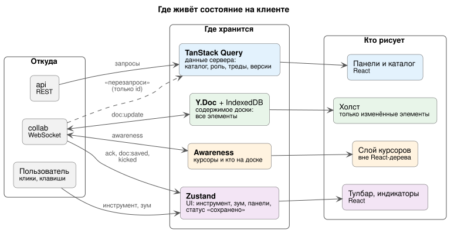
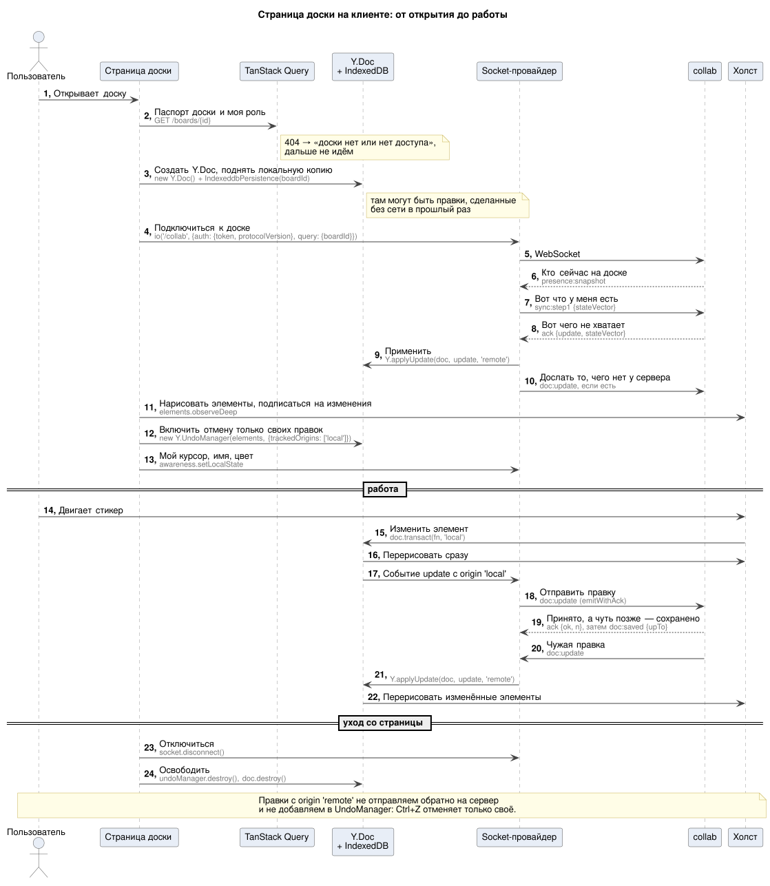
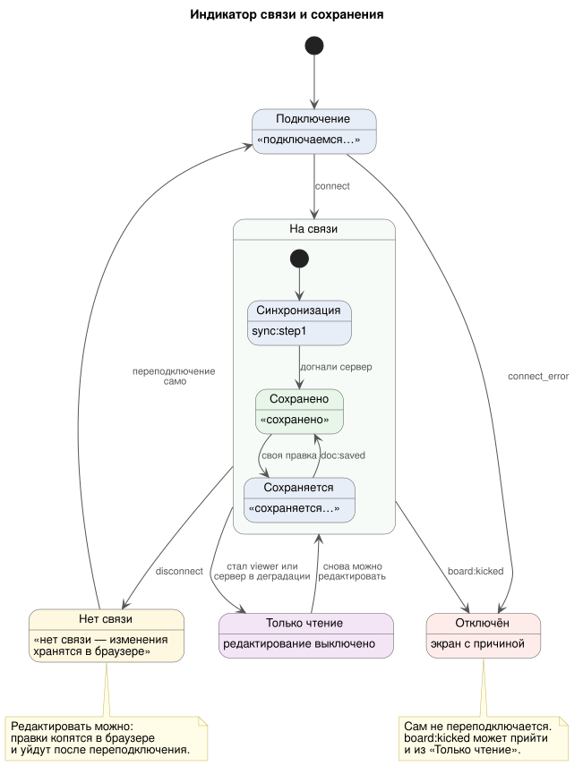

# Фронтенд: как клиент работает с бэком

> **Для кого:** фронтенд-разработчики. Перед этой страницей — [onboarding.md](onboarding.md) (сущности, элементы, роли, список запросов).
> Здесь только то, что следует из принятых решений по архитектуре и контракту. Роуты, нарезку по FSD и выбор библиотек UI фронт-команда решает сама. Библиотеку холста выбираем в прототипе (T0-04).

## 1. Где живёт состояние

| Состояние | Где | Откуда приходит | Пример |
|---|---|---|---|
| Данные сервера | **TanStack Query** | REST. Перезапрос по WS-событиям-инвалидациям | каталог досок, роль на доске, треды, версии, уведомления |
| Содержимое доски | **Y.Doc** (+ `y-indexeddb`) | WS `doc:update` в обе стороны | все элементы |
| Курсоры, выделение, кто на доске | **Awareness** (y-protocols) → отдельный слой | WS `awareness:update`, `presence:snapshot` | курсор Бориса |
| UI | **Zustand** | только клиент + служебные WS-события | инструмент, зум, открытые панели, статус «сохранено» |

Три правила, на которых держится разделение ([deep-dive §14](deep-dive.md)):

1. **Содержимое доски — только в `Y.Doc`.** Не копируем элементы ни в Zustand, ни в Query-кэш. Холст подписывается на изменённые элементы (`observeDeep`), а не перерисовывает всю доску.
2. **Курсоры — вне React-дерева** или с точечными подписками. Движение одного курсора не должно перерисовывать приложение (требование ТЗ).
3. **WS-инвалидации несут только id.** `comments:changed {threadId}` → `invalidateQueries(['threads', boardId])`, а данные перезапрашиваем через REST. Так у каждой зоны остаётся один источник правды.

| WS-событие | Что делает клиент |
|---|---|
| `comments:changed` | `invalidateQueries` тредов доски |
| `version:created` | `invalidateQueries` истории версий |
| `notification:new` | `invalidateQueries` уведомлений, обновить бейдж |
| `ai:progress`, `ai:done` | обновить статус запроса; на `done` — `GET /ai/requests/{id}` за черновиком |
| `file:ready`, `file:failed` | заменить заглушку картинки превью или показать ошибку |
| `board:copy-done` | `invalidateQueries` каталога |
| `version:restored` | тост «Иван восстановил версию от 14:20». Само содержимое придёт обычными `doc:update` |
| `board:permission-changed` | обновить роль; viewer → выключить редактирование |
| `board:kicked`, `server:degraded` | см. §3–4 |

Все события — в [websocket.md §3](api/websocket.md#3-события-сервер--клиент). События из комнаты `user:{id}` (ИИ, уведомления, копирование) приходят во **все вкладки** пользователя на всех досках, поэтому в них есть `boardId`, и фильтровать их по текущей доске должен клиент.

## 2. Страница доски: от открытия до работы

На что обратить внимание:

- **Сначала локальная копия, потом сокет.** `y-indexeddb` поднимает правки, сделанные без сети в прошлый раз (Р-30). Сервер получит их на шаге `sync:step1`: клиент досылает всё, чего нет у сервера, по его state vector.
- **Origin транзакции решает всё.** Свои правки — `doc.transact(fn, 'local')`, чужие — `Y.applyUpdate(doc, u, 'remote')`. На сервер отправляем только `'local'`, `UndoManager` следит только за `'local'` (`trackedOrigins`). Иначе Ctrl+Z отменит чужую правку, а чужая правка улетит обратно на сервер.
- **Одно действие пользователя — одна транзакция.** Перемещение группы, вставка черновика ИИ, удаление выделения: всё внутри одного `transact`. Тогда это одна правка на сервере и один шаг Ctrl+Z.
- **id элементов генерирует клиент** (uuid), сервер не ждём.
- **Большой дифф после долгого офлайна (> 512 КБ) отправляем кусками** `sync:chunk`, следующий кусок — только после ack ([websocket.md §4.3](api/websocket.md#43-переподключение-обрыв-сети-сон-ноутбука-упал-инстанс)). Одно сообщение больше 1 МБ socket.io не отклоняет, а рвёт соединение, и клиент уходит в бесконечный цикл переподключений.
- **Офлайн дольше 24 часов** — документ перезагружаем с нуля, офлайн-правки сливаются так же, пользователь видит предупреждение.

Параметры подключения — [websocket.md §1](api/websocket.md#1-подключение-handshake): только `transports: ['websocket']`, backoff 0,5–10 с с jitter.

## 3. Индикатор связи и сохранения

Главное — **«принято» и «сохранено» разные сигналы** (Р-32):

- **ack** на `doc:update` = сервер принял правку и разослал её другим. В нём номер правки `n`;
- **`doc:saved {upTo}`** = все правки до `n` записаны в БД и переживут падение сервера.

Показываем «сохранено», только когда `upTo` догнал номер последней своей правки. Номера считаются в пределах одного соединения: после переподключения отсчёт начинается заново.

| Состояние | Текст для пользователя | Можно редактировать |
|---|---|:-:|
| Подключение, синхронизация | «подключаемся…» | ✅ локально |
| Сохраняется | «сохраняется…» | ✅ |
| Сохранено | «сохранено» | ✅ |
| Нет связи | «нет связи — изменения хранятся в браузере» | ✅ локально |
| Только чтение | «только просмотр» или «сохранение временно недоступно» | ❌ |
| Отключён | экран с причиной (§4) | ❌ |

## 4. Ошибки: что показать пользователю

### Ответ на `doc:update` (ack с `ok: false`)

Во всех случаях **правка остаётся в локальном `Y.Doc`**: при следующей синхронизации сервер получит её снова или откажет снова.

| Код | Что случилось | Что делает клиент |
|---|---|---|
| `FORBIDDEN` | роль не позволяет писать | выключить редактирование, перезапросить роль (`GET /boards/{id}`) |
| `RATE_LIMITED` | больше 30 правок в секунду | повторить позже; пользователю ничего не показываем |
| `TOO_LARGE` | сообщение больше 1 МБ | это баг клиента: крупное должно идти через `sync:chunk`. Отправить в Sentry |
| `ELEMENT_LIMIT` | доска переполнена | «на доске слишком много элементов». С `ok: true` + `warning` — мягкое предупреждение |
| `INVALID_ELEMENT` | элемент не прошёл схему | сервер уже прислал починку обычным `doc:update`. Отправить в Sentry (`elementIds`). 3 раза за минуту → сервер отключит |
| `BOARD_READ_ONLY` | БД недоступна, сервер в деградации | состояние «только чтение» (§3) |
| `INVALID_UPDATE` | битый update | это баг клиента. Отправить в Sentry |
| `TRANSFER_EXPIRED` | передача кусками не уложилась в 60 с | начать передачу заново с новым `transferId` |

### Ошибка подключения (`connect_error`)

| Код | Что показать | Переподключаться? |
|---|---|:-:|
| `NOT_FOUND` | «доски нет или у вас нет доступа» | ❌ |
| `BOARD_FULL` | «на доске сейчас слишком много людей» | позже |
| `BOARD_NOT_READY` | «доска ещё копируется». Тот, кто копировал, получит `board:copy-done`; остальным — повторить позже | позже |
| `UPGRADE_REQUIRED` | «вышла новая версия — обновите страницу» | ❌ |

### Отключение сервером (`board:kicked {reason}`)

Сразу после события придёт `disconnect`. Автоматически переподключаться **не нужно**.

| `reason` | Что показать |
|---|---|
| `access_revoked` | «доступ к доске закрыт». Если были правки без «сохранено» — «ваши несохранённые изменения не применены» и предложить экспорт в PNG |
| `board_deleted` | «доску удалили» → в каталог |
| `session_revoked` | сессия завершена (например, «выйти на всех устройствах») → на страницу входа |
| `board_full` | «на доске слишком много людей» |

### Деградация (`server:degraded {mode, retryAfterMs?}`)

| `mode` | Что делает клиент |
|---|---|
| `cursors_reduced` | ничего не показываем: курсоры просто обновляются реже |
| `read_only` | состояние «только чтение»; вернуть редактирование после `retryAfterMs` или следующего события |

### REST

Ошибки приходят в формате `application/problem+json` (RFC 9457).

| Статус | Что делает клиент |
|---|---|
| `401` | обновить токен (§5) и повторить запрос **один раз**; не вышло → на страницу входа |
| `404` | «не найдено или нет доступа». Для чужих досок бэк отвечает `404`, а не `403`, чтобы не раскрывать, что доска существует |
| `409` | конфликт состояния (например, восстановление версии уже идёт) — показать причину из `detail` |
| `422 IDEMPOTENCY_KEY_REUSED` | баг клиента: тот же `Idempotency-Key` с другим телом |
| `429` | подождать `Retry-After` |
| `202` | операция идёт в фоне (копирование, восстановление, ИИ): результат придёт WS-событием, а если событие потерялось — через GET |

**Повтор создающих запросов.** `POST` создания (доска, воркспейс, приглашение, ИИ, копирование, восстановление) отправляем с заголовком `Idempotency-Key` (uuid, один на действие пользователя) и при повторе шлём тот же ключ. Двойной клик и ретрай после обрыва тогда не создадут дубль. Для тредов и комментариев id генерирует клиент, заголовок не нужен.

## 5. Авторизация

| Токен | Где хранится | Срок | Как передаётся |
|---|---|---|---|
| access (JWT) | **в памяти** приложения, не в `localStorage` | 15 мин | `Authorization: Bearer …` в REST и `auth.token` в handshake сокета |
| refresh | httpOnly cookie `rt` (`Path=/auth`), JS его не видит | до вехи 3 — без ротации, с вехи 3 — новый при каждом обновлении (Р-60) | браузер сам отправляет cookie на `POST /auth/refresh` |

**Как обновлять:**

1. При загрузке страницы access-токена ещё нет: сразу `POST /auth/refresh`. Ответ `401` → страница входа.
2. На `401` от REST — обновить токен и повторить запрос один раз.
3. **В пределах вкладки — один refresh за раз.** Если на `401` упали пять запросов, refresh отправляется один, а остальные ждут его результат.
4. **Открытому сокету новый токен отправляем событием `auth:refresh {token}`.** Переподключаться ради этого не нужно. Если токен истёк и за минуту не пришёл новый, сервер отключит сокет.
5. Выход — `POST /auth/logout` (текущая сессия). С вехи 3 появится `?all=true`: отзывает все сессии, и открытые доски получают `board:kicked {session_revoked}`.

**С вехи 3, когда появится ротация refresh (Р-60):**

6. **Несколько вкладок — один refresh на всех** ([Р-59](decisions.md#продукт)). Refresh ротируется при каждом обновлении, а повтор старого refresh бэк считает кражей и отзывает все сессии. Если две вкладки обновят токен одновременно, пользователя разлогинит везде. Поэтому:
   - обновление идёт под `navigator.locks.request('auth-refresh', …)` (Web Locks API): одновременно его выполняет только одна вкладка;
   - новый access-токен эта вкладка рассылает остальным через `BroadcastChannel`, и они не ходят за своим;
   - страховка на бэке: 10 с после ротации предыдущий refresh принимается как повтор и возвращает ту же новую пару токенов (на случай, если ответ потерялся в сети).

## 6. Что фронт делает сам, без бэка

- **Undo/redo** — `Y.UndoManager` только по своим правкам (`trackedOrigins: ['local']`). С историей версий это не связано.
- **Экспорт в PNG** — рендер на клиенте (Р-12).
- **Превью черновика ИИ** — «призрачные» элементы поверх холста, в `Y.Doc` не попадают. «Применить» = вставить элементы одной транзакцией `'local'`, тогда их можно отменить одним Ctrl+Z (Р-9).
- **Геометрия соединителей** — по id элементов на концах.
- **Тост «элемент удалил A»** — когда элемент, который пользователь сейчас правит, исчез из `Y.Doc` (Р-13).

## 7. Где проверять

Критерии приёмки клиентских сценариев — в [acceptance.md](acceptance.md): совместная работа (US-4, US-5), отмена своих действий (US-6), обрыв связи (US-7), «сохранено» (US-8), наблюдатель (US-9). Задачи фронта по вехам — в [backlog.md](backlog.md), колонка «Кто»: `фронт` и `вместе`.
