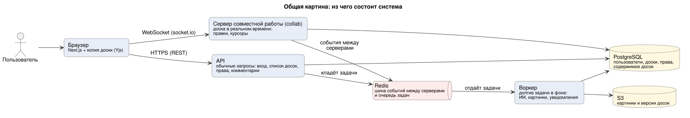
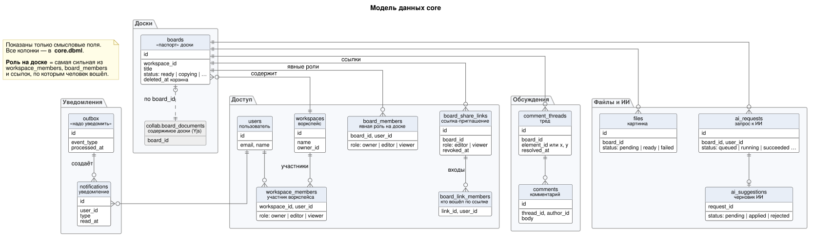
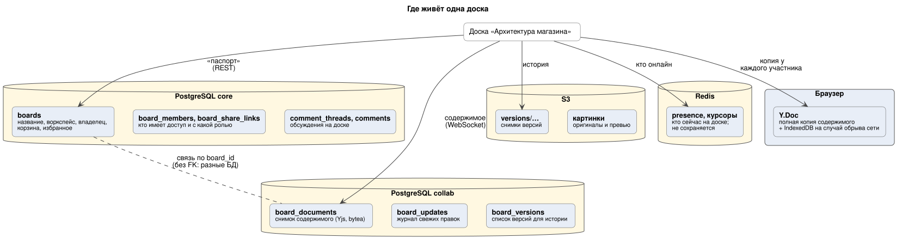
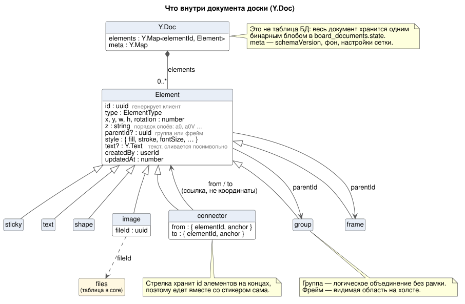
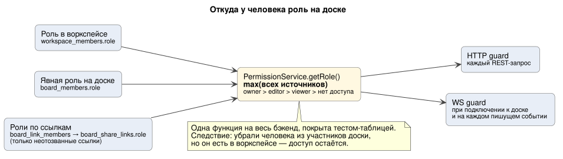

# С чего начать

> **Для кого:** вся команда, фронт и бэк. **Время:** ~20 минут.
> Эта страница — вход в документацию. Она отвечает на три вопроса: **что мы строим и с чего начать**, **какие есть сущности и элементы**, **какие запросы ходят между фронтом и бэком**. Подробности — по ссылкам, читать всё подряд не нужно.

## 1. Что мы строим

Аналог Miro: доски, на которых несколько человек одновременно рисуют стикеры, фигуры и стрелки, комментируют, откатывают версии и зовут на помощь ИИ.

Главный сценарий из ТЗ, вокруг которого строится MVP: **создать доску → добавить элементы → пригласить коллегу → править вместе в реальном времени → всё сохранилось само.**

Главное, что нужно понять про устройство: **у браузера два канала связи с бэком.**

| Канал | Что через него идёт | Сервер |
|---|---|---|
| **REST** (HTTPS) | всё, кроме содержимого доски: вход, список досок, права, комментарии, версии, файлы, ИИ | `api` |
| **WebSocket** (socket.io) | содержимое открытой доски: правки элементов, курсоры, события «тебя отключили», «версия восстановлена» | `collab` |

Долгие задачи (ИИ, обработка картинок, уведомления, уборка журнала правок) делает `worker` в фоне через очередь.

> Масштаб — **1 000 пользователей в день на одном VPS** ([Р-43, Р-44](decisions.md#масштаб-и-инфраструктура)). Архитектура при этом готова к росту без переписывания кода — что меняется при росте, описано в [README §8](README.md#8-как-будем-расти).

## 2. С чего начать прямо сейчас

Мы на **вехе 0 — прототип** ([roadmap](roadmap.md#вехи)). Цель вехи — не написать хороший код, а снять главные риски: заработает ли совместное редактирование на Yjs, какую библиотеку холста брать, сколько выдержит один процесс. Код прототипа в продукт не переносим, переносим выводы.

Параллельно идёт **веха 1 — фундамент**: монорепо (`apps/web`, `apps/server`) и каркас NestJS с `/health` уже есть в репозитории.

| Кто | Первые задачи ([backlog](backlog.md#веха-0-прототип)) | Что прочитать перед стартом |
|---|---|---|
| **Бэк** | T0-01: socket.io + Yjs, квадрат двигается в двух вкладках (issue #2) → T0-02: два инстанса + Redis → T0-03: запись в Postgres и компакция | §3–4 этой страницы · [схемы 01–03](sequences/README.md) · [deep-dive §1](deep-dive.md#1-как-синхронизировать-доску-crdt-yjs) · [websocket.md §0–4](api/websocket.md) |
| **Фронт** | T0-04: сравнить 2–3 библиотеки холста → T0-05 (вместе с бэком): подключить холст к `Y.Doc` | §3–4 этой страницы · [схемы 01–03](sequences/README.md) · **[frontend.md](frontend.md)** — как клиент работает с бэком · [glossary, часть 2](glossary.md#часть-2-технические-термины) — термины бэка с аналогиями из фронта |
| **Все** | договориться об именах | [glossary, часть 1](glossary.md#часть-1-имена-в-коде-общий-словарь-фронта-и-бэка): одно имя на сущность во всех слоях |

**Порядок чтения после этой страницы:** [простые sequence-диаграммы](sequences/README.md) → [README](README.md) (разделы 0–3, 7) → [architecture/README.md](architecture/README.md) → [deep-dive](deep-dive.md) §1–4 → остальное по задаче.

## 3. Сущности

### Главные сущности

| Сущность | В коде | Что это | Где лежит |
|---|---|---|---|
| Пользователь | `User` | аккаунт: email, имя, аватар, Telegram | core: `users` |
| Воркспейс | `Workspace` | команда, в которой лежат доски | core: `workspaces` |
| Участник воркспейса | `WorkspaceMember` | человек в воркспейсе с ролью | core: `workspace_members` |
| Приглашение в воркспейс | `WorkspaceInvite` | по email, живёт 7 дней | core: `workspace_invites` |
| Доска | `Board` | «паспорт» доски: название, владелец, корзина | core: `boards` |
| Участник доски | `BoardMember` | явная роль человека на конкретной доске | core: `board_members` |
| Ссылка-приглашение | `ShareLink` | ссылка с ролью `editor` или `viewer` | core: `board_share_links` |
| Документ доски | `BoardDocument` | **всё содержимое доски** одним Yjs-документом | collab: `board_documents` + журнал `board_updates` |
| Элемент | `Element` | стикер, фигура, стрелка и т. д. **Не таблица**, а запись внутри документа | внутри `BoardDocument` (§4) |
| Версия | `BoardVersion` | сохранённое состояние для истории | collab: `board_versions` + снимок в S3 |
| Тред, комментарий | `CommentThread`, `Comment` | обсуждение, привязанное к элементу или точке | core: `comment_threads`, `comments` |
| Файл | `File` | загруженная картинка | core: `files` + файл в S3 |
| Запрос к ИИ, черновик ИИ | `AiRequest`, `AiSuggestion` | запрос пользователя и результат, который можно применить | core: `ai_requests`, `ai_suggestions` |
| Уведомление | `Notification` | «вас упомянули», «вас пригласили» | core: `notifications` |

Все колонки и служебные таблицы — в [core.dbml](database/core.dbml) и [collab.dbml](database/collab.dbml). Канонические имена и запрещённые синонимы — [glossary](glossary.md#сущности).

### Где живёт одна доска

Самое неочевидное место: **доска разложена по нескольким хранилищам**, и «паспорт» доски отделён от её содержимого.

- **Паспорт** (название, права, корзина) — обычные строки в Postgres `core`. Фронт получает его через REST: `GET /boards/{id}`.
- **Содержимое** (все элементы) — один бинарный Yjs-документ в отдельной БД `collab`. Фронт получает его **только через WebSocket**, REST-эндпоинта «дай элементы доски» нет и не будет.
- **Кто сейчас на доске и где их курсоры** — только в памяти и Redis, никогда не сохраняется.
- У каждого участника в браузере **полная копия** документа. Поэтому правка видна сразу, а после обрыва сети доска досинхронизируется сама.

## 4. Элементы на доске

| Тип (`type`) | Что это | Особые поля |
|---|---|---|
| `sticky` | стикер | `text` |
| `text` | текстовый блок с форматированием | `text` |
| `shape` | фигура: прямоугольник, круг и т. д. | `style` |
| `image` | картинка | `fileId` → таблица `files`, сам файл в S3 |
| `connector` | линия или стрелка между элементами | `from`, `to` — **id элементов**, а не координаты |
| `group` | логическое объединение без рамки | дети ссылаются на неё через `parentId` |
| `frame` | видимая область, в которую кладут элементы | дети ссылаются на него через `parentId` |

Правила, которые важны и фронту, и бэку:

- **id элемента генерирует клиент** (uuid). Поэтому элемент появляется на экране мгновенно, а повторная отправка не создаёт дубль.
- **Стрелка хранит id своих концов.** Геометрию линии считает клиент, поэтому при перемещении стикера стрелка «едет» сама, и правка соединителя не нужна.
- **Перемещение группы — одна транзакция Yjs** (меняет `x`/`y` у всех детей), значит, отменяется одним Ctrl+Z.
- **Undo/redo только своих действий** делает клиент (`Y.UndoManager`). Сервер в этом не участвует, с историей версий это не связано.
- **Порядок слоёв** — строка `z` (fractional index), чтобы двое могли одновременно менять порядок без конфликтов.

Источник модели — [database/README.md §2](database/README.md#2-модель-документа-доски-внутри-yjs). Что происходит в спорных случаях («A удалил, B двигает») — [deep-dive §2](deep-dive.md#2-конфликты-что-происходит-в-спорных-случаях).

## 5. Роли и права

Ролей три: **owner · editor · viewer** ([Р-50](decisions.md#продукт)). Отдельной роли «комментатор» нет: комментировать может и viewer. Права проверяет бэк — и в HTTP, и в WebSocket. Фронт только прячет кнопки, на его проверки не полагаемся.

**На доске** (итоговая роль — самая сильная из трёх источников на схеме):

| Действие | viewer | editor | owner | Как проверяется |
|---|:-:|:-:|:-:|---|
| Открыть доску, видеть правки и курсоры других | ✅ | ✅ | ✅ | WS: при подключении |
| Показывать свой курсор | ✅ | ✅ | ✅ | WS: `awareness:update` |
| Менять элементы | ❌ | ✅ | ✅ | WS: `doc:update` → `FORBIDDEN` |
| Добавить в избранное | ✅ | ✅ | ✅ | REST |
| Переименовать доску | ❌ | ✅ | ✅ | REST |
| Создать тред, ответить | ✅ | ✅ | ✅ | REST |
| Править и удалять свой комментарий | ✅ | ✅ | ✅ | REST: только автор |
| Удалить чужой комментарий | ❌ | ❌ | ✅ | REST |
| Сохранить версию, восстановить версию | ❌ | ✅ | ✅ | REST |
| Загрузить картинку | ❌ | ✅ | ✅ | REST |
| Запрос к ИИ | ❌ | ✅ | ✅ | REST + квота |
| Выдать или отозвать доступ, ссылки-приглашения | ❌ | ❌ | ✅ | REST |
| Удалить в корзину, вернуть, удалить навсегда | ❌ | ❌ | ✅ | REST |
| Решить и переоткрыть тред | ✅ | ✅ | ✅ | REST ([Р-51](decisions.md#продукт)) |
| Смотреть историю версий | ✅ | ✅ | ✅ | REST (Р-51) |
| Копировать доску | ✅ | ✅ | ✅ | REST: нужен ещё editor+ в воркспейсе, куда копируем (Р-51) |

**В воркспейсе:** создать доску — editor+; пригласить по email — owner или editor; переименовать, удалить воркспейс, менять роли участников — owner.

Если права изменились, пока человек на доске: понизили до viewer → `board:permission-changed`, редактирование выключается; доступ отозвали → `board:kicked` и отключение ([схема 04](sequences/04-revoke-access.svg)).

## 6. Запросы: экран → что шлёт фронт → кто отвечает на бэке

Полный контракт — [api/rest_api.yml](api/rest_api.yml) (открыть в [Swagger Editor](https://editor.swagger.io)) и [api/websocket.md](api/websocket.md). Колонка «Модуль» — модуль NestJS из [architecture §2](architecture/README.md#модули-nestjs-и-слои). Колонка «Веха» — когда это делаем по [roadmap](roadmap.md#вехи).

### Вход и регистрация · модуль `auth`, `users`

| Действие пользователя | Запрос | Веха |
|---|---|---|
| Зарегистрироваться, войти | `POST /auth/register`, `POST /auth/login` | 1 |
| (фоном) обновить access-токен | `POST /auth/refresh` — refresh лежит в cookie | 1 |
| Выйти | `POST /auth/logout`; «выйти везде» (`?all=true`) | 1 / 3 |
| Войти через GitHub | `GET /auth/oauth/{provider}` | 9 |
| Профиль | `GET /me`, `PATCH /me` | 1 |

### Каталог досок · модули `workspaces`, `boards`

| Действие пользователя | Запрос | Веха |
|---|---|---|
| Увидеть свои воркспейсы, создать новый | `GET /workspaces`, `POST /workspaces` | 2 |
| Список досок с поиском и фильтрами | `GET /workspaces/{id}/boards` | 2 (поиск — 4) |
| Создать доску | `POST /workspaces/{id}/boards` + заголовок `Idempotency-Key` | 2 |
| Переименовать, в избранное | `PATCH /boards/{id}` | 2 / 4 |
| Копировать | `POST /boards/{id}/copy` → потом WS `board:copy-done` | 4 |
| Удалить в корзину, корзина, вернуть, удалить навсегда | `DELETE /boards/{id}`, `GET /workspaces/{id}/trash`, `POST /boards/{id}/restore`, `DELETE /boards/{id}/permanent` | 4 |
| Участники воркспейса, пригласить по email | `GET/PATCH/DELETE /workspaces/{id}/members/…`, `POST /workspaces/{id}/invites`, `POST /invites/{token}/accept` | 2 / 4 |

### Доска: холст · модуль `collab` (WebSocket)

| Действие пользователя | Запрос / событие | Веха |
|---|---|---|
| Открыть доску | `GET /boards/{id}` (паспорт + моя роль) → WS-подключение `/collab?boardId=…` → `presence:snapshot` → `sync:step1` ([схема 01](sequences/01-open-board.svg)) | 0 / 2 |
| Добавить, подвинуть, удалить элемент | клиент меняет локальный `Y.Doc` → `doc:update`; ответ: ack «принято», позже `doc:saved` «сохранено» ([схема 02](sequences/02-edit.svg)) | 0 / 2 |
| Видеть правки других | сервер шлёт `doc:update` | 0 / 2 |
| Видеть курсоры и кто на доске | `awareness:update` в обе стороны | 0 / 2 |
| Пропала сеть | socket.io переподключается сам → снова `sync:step1` ([схема 03](sequences/03-reconnect.svg)) | 0 / 2 |

### Доска: «Поделиться» · модуль `sharing`

| Действие пользователя | Запрос / событие | Веха |
|---|---|---|
| Кто имеет доступ | `GET /boards/{id}/members` (с источником роли) | 2 |
| Выдать, изменить, отозвать доступ | `POST/PATCH/DELETE /boards/{id}/members/…` → у затронутого WS `board:permission-changed` или `board:kicked` | 2 |
| Создать, отозвать ссылку-приглашение | `GET/POST /boards/{id}/share-links`, `DELETE /boards/{id}/share-links/{linkId}` | 2 |
| Перейти по ссылке | `POST /share-links/{token}/join` ([схема 05](sequences/05-create-and-invite.svg)) | 2 |

### Доска: комментарии · модуль `comments`

| Действие пользователя | Запрос / событие | Веха |
|---|---|---|
| Треды доски | `GET /boards/{id}/threads`; при изменениях WS `comments:changed` → перезапросить | 5 |
| Новый тред, ответ | `POST /boards/{id}/threads`, `POST /threads/{id}/comments` | 5 |
| Решить, переоткрыть | `PATCH /threads/{id}` | 5 |
| Править, удалить комментарий | `PATCH/DELETE /comments/{id}` | 5 |

### Доска: история версий · модуль `history`

| Действие пользователя | Запрос / событие | Веха |
|---|---|---|
| Список версий, сохранить версию с именем | `GET/POST /boards/{id}/versions`; WS `version:created` | 6 |
| Посмотреть версию | `GET /boards/{id}/versions/{versionId}` → ссылка на снимок, клиент рисует read-only | 6 |
| Восстановить | `POST /boards/{id}/versions/{versionId}/restore` → у всех WS `version:restored` ([схема 07](sequences/07-version-restore.svg)) | 6 |

### Доска: картинки · модуль `files`

| Действие пользователя | Запрос / событие | Веха |
|---|---|---|
| Вставить картинку | `POST /boards/{id}/files` → загрузка прямо в S3 → `POST /files/{id}/complete` → WS `file:ready` / `file:failed` ([схема 09](sequences/09-image-upload.svg)) | 7 |
| Показать картинку | `GET /files/{id}` → URL превью | 7 |

### Доска: ИИ · модуль `ai`

| Действие пользователя | Запрос / событие | Веха |
|---|---|---|
| Попросить ИИ | `POST /boards/{id}/ai/requests` → `202`; WS `ai:progress`, `ai:done` ([схема 08](sequences/08-ai-request.svg)) | 8 |
| Получить черновик | `GET /ai/requests/{id}` | 8 |
| Отменить | `DELETE /ai/requests/{id}` | 8 |
| Применить или отклонить | применить = обычный `doc:update` от клиента; в обоих случаях `POST /ai/requests/{id}/decision` | 8 |

### Кабинет и уведомления · модули `users`, `notifications`

| Действие пользователя | Запрос / событие | Веха |
|---|---|---|
| Уведомления, отметить прочитанными | `GET /notifications`, `POST /notifications/read`; новое — WS `notification:new` | 5 |
| Привязать, отвязать Telegram | `POST/DELETE /me/telegram/link` | 5 |

### Что делается только на клиенте, без запросов

- **pan/zoom, выделение, геометрия стрелок** — холст;
- **undo/redo** своих действий — `Y.UndoManager`;
- **экспорт в PNG** — рендер на клиенте (Р-12);
- **превью черновика ИИ** до нажатия «Применить» — «призрачные» элементы поверх холста, в документ не попадают.

## 7. Частые вопросы

**Где в базе таблица стикеров?** Её нет. Все элементы живут внутри одного Yjs-документа доски (§4), а он хранится в `board_documents` одним бинарным полем. Почему так — [database/README.md §1](database/README.md#1-какие-хранилища-и-почему).

**Почему содержимое доски не через REST?** Правки идут десятками в секунду от нескольких людей сразу. Через WebSocket сервер рассылает их всем мгновенно, а Yjs сам сводит одновременные правки без конфликтов ([deep-dive §1](deep-dive.md#1-как-синхронизировать-доску-crdt-yjs)).

**Что будет, если двое одновременно двигают один стикер?** У обоих в итоге окажется одно и то же положение. Какое именно победит, решает Yjs, но у всех одинаково ([deep-dive §2](deep-dive.md#2-конфликты-что-происходит-в-спорных-случаях)).

**Почему «принято» и «сохранено» — разные сигналы?** Сервер сразу рассылает правку другим, а в базу пишет пачкой раз в секунду. «Сохранено» приходит, когда пачка реально записана ([схема 02](sequences/02-edit.svg)).

**Где общие типы для фронта и бэка?** В пакете `packages/contracts` (zod-схемы), задача T1-09. Пока его нет — договариваемся по [glossary](glossary.md) и [rest_api.yml](api/rest_api.yml).

**Нашёл противоречие или непонятное место?** Запиши вопрос в [«Открытые вопросы»](decisions.md#открытые-вопросы) журнала решений. Принятое решение — новая строка в [decisions.md](decisions.md).
