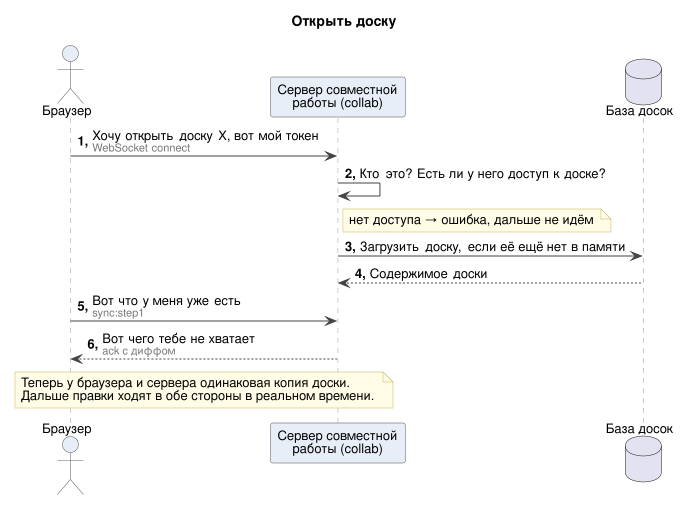
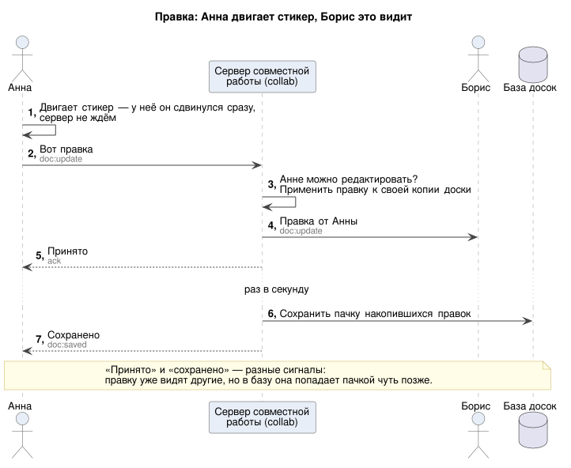
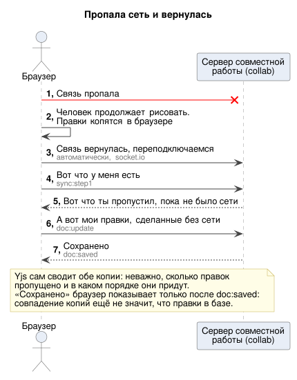
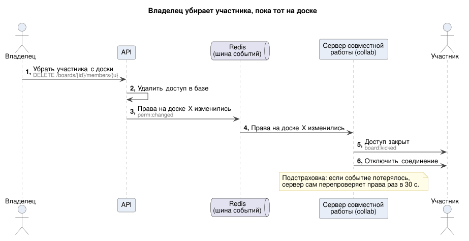
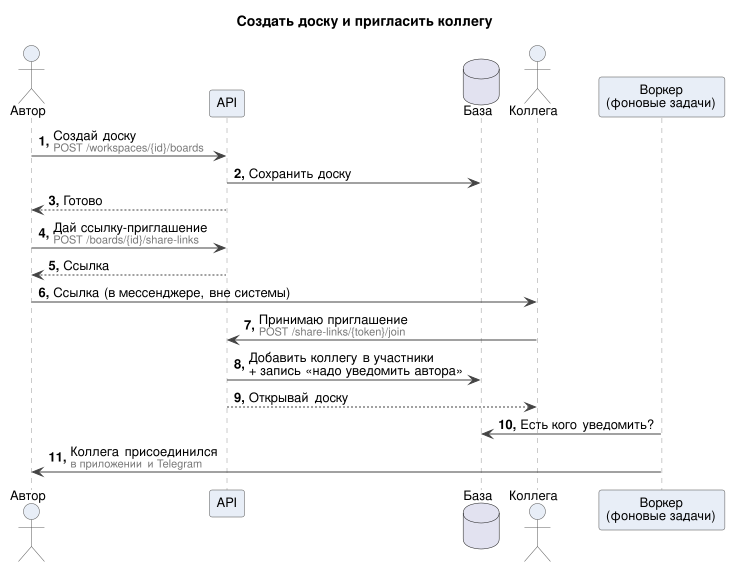
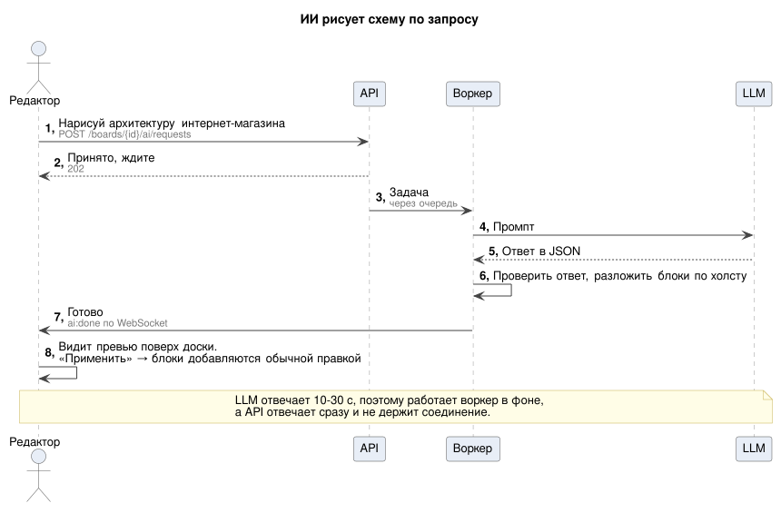
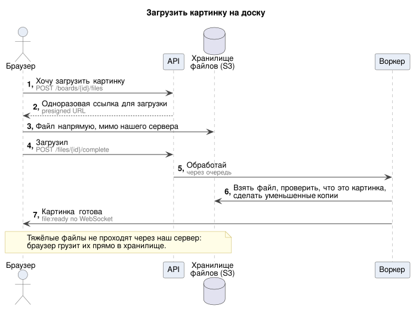
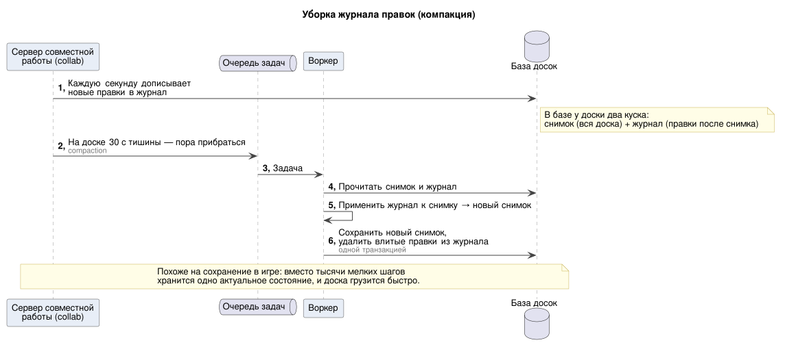
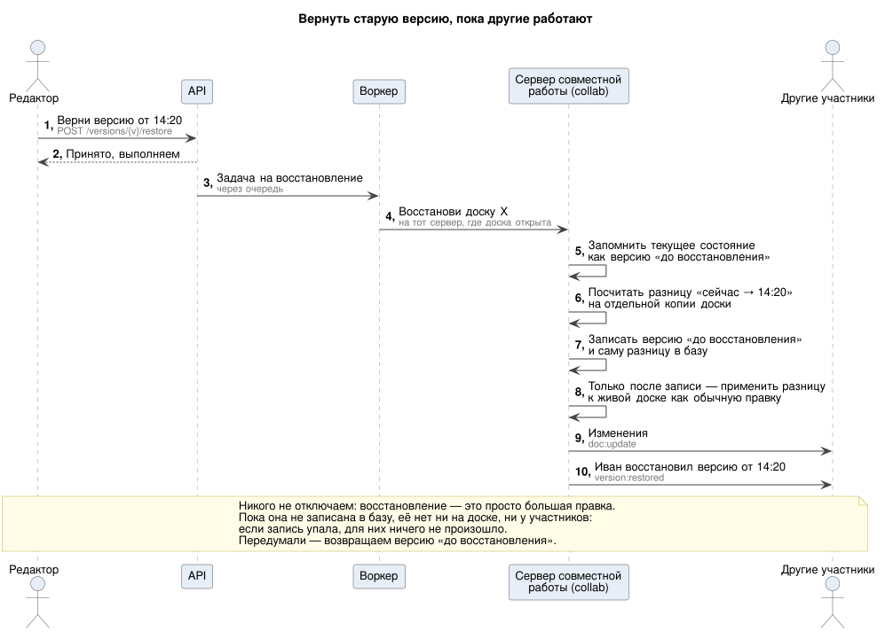

# Sequence-диаграммы взаимодействия

Кто кому что отправляет в ключевых сценариях. Подписи на стрелках — обычным языком, под ними мелким серым — техническое имя события или запроса: его удобно искать в коде, в [websocket.md](../api/websocket.md) и [rest_api.yml](../api/rest_api.yml).

## Начни с этого (5 минут)

Три схемы, на которых держится весь проект. Без них непонятно, почему правка видна сразу, а «сохранено» приходит позже.

### 01. Открыть доску

### 02. Правка: Анна двигает стикер, Борис это видит

### 03. Пропала сеть и вернулась

Как это выглядит со стороны клиента (Y.Doc, IndexedDB, отмена только своих правок) — [frontend.md §2](../frontend.md#2-страница-доски-от-открытия-до-работы).

## Когда дойдёшь до фичи

### 04. Владелец убирает участника, пока тот на доске

Фронт должен обработать `board:kicked` и `board:permission-changed` ([frontend.md §4](../frontend.md#4-ошибки-что-показать-пользователю)).

### 05. Создать доску и пригласить коллегу

Обычный REST — хорошая первая задача.

### 08. ИИ рисует схему

Шаблон «долгой операции»: ответ `202` → ждём событие по WebSocket → забираем результат через GET. Так же устроены копирование доски и восстановление версии.

### 09. Загрузить картинку

Файл идёт прямо в S3 по одноразовой ссылке, мимо нашего сервера.

## Как устроено внутри бэка

Фронт видит от этих сценариев только результат. Схемы нужны тем, кто их реализует.

### 06. Уборка журнала правок (компакция)

### 07. Вернуть старую версию, пока другие работают

## Подробные версии

Со всеми проверками, ветками ошибок и SQL — для тех, кто пишет этот код.

| Сценарий | Подробная схема | Откуда в документации |
|---|---|---|
| 01. Открыть доску | [detailed/01-open-board.svg](detailed/01-open-board.svg) | [websocket.md §1, §4.1](../api/websocket.md#41-открытие-доски) |
| 02. Правка | [detailed/02-edit.svg](detailed/02-edit.svg) | [websocket.md §4.2](../api/websocket.md#42-правка) |
| 03. Пропала сеть | [detailed/03-reconnect.svg](detailed/03-reconnect.svg) | [websocket.md §4.3](../api/websocket.md#43-переподключение-обрыв-сети-сон-ноутбука-упал-инстанс) |
| 07. Восстановление версии | [detailed/07-version-restore.svg](detailed/07-version-restore.svg) | [deep-dive §5](../deep-dive.md#5-восстановление-версии-пока-другие-работают) |

## Как править

Исходники — `NN-*.puml` (PlantUML), общий стиль — [_style.iuml](_style.iuml). SVG генерирует [../scripts/render.sh](../scripts/render.sh). Если текст документации и схема расходятся, правду говорит текст: правим `.puml` и перегенерируем.
